# 全部模块静态引用图

箭头 A→B 表示 A 模块文件引用了 B 模块中识别出的类型。边上数字是去重的文件—类型引用数，不是运行频率或调用次数。该图由语法扫描生成；不含反射、委托和 Harmony 隐式事件边，不能据此认定未引用成员可删除。

```mermaid
flowchart LR
  m0["Adventure"]
  m1["Aliases"]
  m2["Beasts"]
  m3["Combat"]
  m4["Core"]
  m5["Crafting"]
  m6["Cultivation"]
  m7["Data"]
  m8["Death"]
  m9["Entry"]
  m10["Family"]
  m11["Grant"]
  m12["Interop"]
  m13["Patches"]
  m14["Progression"]
  m15["Queries"]
  m16["Reincarnation"]
  m17["Runtime"]
  m18["Traits"]
  m19["UI"]
  m20["Visual"]
  m21["WorldResources"]
  m22["WorldSoul"]
  m6 -->|"87"| m7
  m6 -->|"77"| m17
  m19 -->|"72"| m7
  m19 -->|"60"| m17
  m6 -->|"57"| m4
  m6 -->|"54"| m21
  m19 -->|"53"| m4
  m5 -->|"48"| m7
  m17 -->|"45"| m6
  m21 -->|"45"| m7
  m17 -->|"43"| m4
  m6 -->|"33"| m18
  m2 -->|"30"| m4
  m19 -->|"30"| m6
  m21 -->|"26"| m6
  m19 -->|"26"| m21
  m0 -->|"25"| m21
  m21 -->|"25"| m4
  m2 -->|"24"| m7
  m10 -->|"24"| m7
  m16 -->|"24"| m4
  m5 -->|"22"| m4
  m10 -->|"21"| m17
  m20 -->|"20"| m4
  m21 -->|"20"| m17
  m17 -->|"19"| m5
  m4 -->|"18"| m17
  m17 -->|"18"| m7
  m5 -->|"17"| m17
  m18 -->|"17"| m7
  m19 -->|"17"| m18
  m13 -->|"16"| m4
  m18 -->|"16"| m4
  m19 -->|"16"| m5
  m0 -->|"15"| m6
  m0 -->|"15"| m7
  m6 -->|"15"| m5
  m10 -->|"15"| m4
  m17 -->|"15"| m21
  m18 -->|"15"| m17
  m13 -->|"14"| m2
  m2 -->|"14"| m17
  m3 -->|"14"| m7
  m4 -->|"13"| m19
  m0 -->|"13"| m17
  m18 -->|"13"| m2
  m18 -->|"13"| m6
  m4 -->|"12"| m2
  m2 -->|"12"| m18
  m3 -->|"12"| m17
  m16 -->|"12"| m17
  m22 -->|"12"| m17
  m13 -->|"11"| m17
  m5 -->|"11"| m6
  m14 -->|"11"| m17
  m17 -->|"11"| m18
  m22 -->|"11"| m7
  m19 -->|"11"| m0
  m13 -->|"10"| m18
  m2 -->|"10"| m6
  m22 -->|"10"| m21
  m13 -->|"9"| m19
  m3 -->|"9"| m4
  m5 -->|"9"| m21
  m8 -->|"9"| m4
  m10 -->|"9"| m21
  m14 -->|"9"| m6
  m17 -->|"9"| m2
  m19 -->|"9"| m16
  m9 -->|"8"| m13
  m4 -->|"8"| m5
  m13 -->|"8"| m5
  m3 -->|"8"| m6
  m6 -->|"8"| m2
  m11 -->|"8"| m4
  m11 -->|"8"| m6
  m14 -->|"8"| m21
  m16 -->|"8"| m21
  m16 -->|"8"| m7
  m22 -->|"8"| m4
  m22 -->|"8"| m6
  m19 -->|"8"| m10
  m19 -->|"8"| m2
  m9 -->|"7"| m4
  m15 -->|"7"| m6
  m0 -->|"7"| m4
  m8 -->|"7"| m17
  m10 -->|"7"| m5
  m17 -->|"7"| m0
  m20 -->|"7"| m2
  m9 -->|"6"| m18
  m4 -->|"6"| m21
  m4 -->|"6"| m20
  m8 -->|"6"| m7
  m14 -->|"6"| m7
  m19 -->|"6"| m3
  m4 -->|"5"| m6
  m15 -->|"5"| m7
  m3 -->|"5"| m18
  m5 -->|"5"| m18
  m6 -->|"5"| m15
  m8 -->|"5"| m21
  m17 -->|"5"| m3
  m17 -->|"5"| m10
  m20 -->|"5"| m18
  m18 -->|"5"| m21
  m18 -->|"5"| m11
  m13 -->|"4"| m8
  m15 -->|"4"| m17
  m0 -->|"4"| m18
  m0 -->|"4"| m3
  m2 -->|"4"| m21
  m11 -->|"4"| m7
  m14 -->|"4"| m4
  m14 -->|"4"| m16
  m16 -->|"4"| m18
  m16 -->|"4"| m6
  m17 -->|"4"| m15
  m20 -->|"4"| m7
  m22 -->|"4"| m18
  m19 -->|"4"| m15
  m19 -->|"4"| m9
  m9 -->|"3"| m5
  m4 -->|"3"| m16
  m4 -->|"3"| m3
  m13 -->|"3"| m3
  m13 -->|"3"| m20
  m15 -->|"3"| m4
  m2 -->|"3"| m9
  m3 -->|"3"| m5
  m6 -->|"3"| m0
  m6 -->|"3"| m8
  m6 -->|"3"| m11
  m6 -->|"3"| m14
  m6 -->|"3"| m20
  m8 -->|"3"| m6
  m10 -->|"3"| m6
  m11 -->|"3"| m18
  m11 -->|"3"| m17
  m21 -->|"3"| m14
  m21 -->|"3"| m5
  m22 -->|"3"| m8
  m9 -->|"2"| m19
  m9 -->|"2"| m3
  m9 -->|"2"| m2
  m4 -->|"2"| m7
  m4 -->|"2"| m10
  m4 -->|"2"| m8
  m4 -->|"2"| m14
  m4 -->|"2"| m13
  m4 -->|"2"| m18
  m13 -->|"2"| m6
  m13 -->|"2"| m9
  m15 -->|"2"| m21
  m0 -->|"2"| m5
  m0 -->|"2"| m8
  m3 -->|"2"| m15
  m5 -->|"2"| m19
  m6 -->|"2"| m19
  m6 -->|"2"| m16
  m8 -->|"2"| m10
  m8 -->|"2"| m2
  m8 -->|"2"| m16
  m11 -->|"2"| m19
  m16 -->|"2"| m8
  m16 -->|"2"| m3
  m17 -->|"2"| m22
  m17 -->|"2"| m14
  m17 -->|"2"| m8
  m20 -->|"2"| m9
  m20 -->|"2"| m17
  m21 -->|"2"| m18
  m21 -->|"2"| m16
  m21 -->|"2"| m15
  m22 -->|"2"| m14
  m18 -->|"2"| m20
  m19 -->|"2"| m20
  m9 -->|"1"| m21
  m9 -->|"1"| m6
  m9 -->|"1"| m17
  m9 -->|"1"| m12
  m9 -->|"1"| m20
  m4 -->|"1"| m9
  m4 -->|"1"| m22
  m4 -->|"1"| m12
  m7 -->|"1"| m4
  m7 -->|"1"| m6
  m7 -->|"1"| m3
  m13 -->|"1"| m22
  m13 -->|"1"| m7
  m13 -->|"1"| m15
  m13 -->|"1"| m11
  m13 -->|"1"| m16
  m15 -->|"1"| m8
  m15 -->|"1"| m18
  m0 -->|"1"| m15
  m0 -->|"1"| m14
  m0 -->|"1"| m10
  m2 -->|"1"| m20
  m2 -->|"1"| m5
  m3 -->|"1"| m11
  m3 -->|"1"| m19
  m5 -->|"1"| m10
  m5 -->|"1"| m3
  m6 -->|"1"| m22
  m6 -->|"1"| m3
  m6 -->|"1"| m10
  m8 -->|"1"| m22
  m8 -->|"1"| m3
  m8 -->|"1"| m15
  m8 -->|"1"| m14
  m10 -->|"1"| m18
  m11 -->|"1"| m5
  m11 -->|"1"| m15
  m11 -->|"1"| m16
  m11 -->|"1"| m3
  m14 -->|"1"| m18
  m16 -->|"1"| m14
  m16 -->|"1"| m15
  m17 -->|"1"| m19
  m17 -->|"1"| m9
  m17 -->|"1"| m16
  m20 -->|"1"| m21
  m21 -->|"1"| m8
  m21 -->|"1"| m22
  m21 -->|"1"| m10
  m21 -->|"1"| m19
  m18 -->|"1"| m5
  m19 -->|"1"| m8
  m19 -->|"1"| m22
  m19 -->|"1"| m13
```

## 模块连接表

|引用方|被引用方|文件—类型引用数|
|---|---|---:|
|Cultivation|Data|87|
|Cultivation|Runtime|77|
|UI|Data|72|
|UI|Runtime|60|
|Cultivation|Core|57|
|Cultivation|WorldResources|54|
|UI|Core|53|
|Crafting|Data|48|
|Runtime|Cultivation|45|
|WorldResources|Data|45|
|Runtime|Core|43|
|Cultivation|Traits|33|
|Beasts|Core|30|
|UI|Cultivation|30|
|WorldResources|Cultivation|26|
|UI|WorldResources|26|
|Adventure|WorldResources|25|
|WorldResources|Core|25|
|Beasts|Data|24|
|Family|Data|24|
|Reincarnation|Core|24|
|Crafting|Core|22|
|Family|Runtime|21|
|Visual|Core|20|
|WorldResources|Runtime|20|
|Runtime|Crafting|19|
|Core|Runtime|18|
|Runtime|Data|18|
|Crafting|Runtime|17|
|Traits|Data|17|
|UI|Traits|17|
|Patches|Core|16|
|Traits|Core|16|
|UI|Crafting|16|
|Adventure|Cultivation|15|
|Adventure|Data|15|
|Cultivation|Crafting|15|
|Family|Core|15|
|Runtime|WorldResources|15|
|Traits|Runtime|15|
|Patches|Beasts|14|
|Beasts|Runtime|14|
|Combat|Data|14|
|Core|UI|13|
|Adventure|Runtime|13|
|Traits|Beasts|13|
|Traits|Cultivation|13|
|Core|Beasts|12|
|Beasts|Traits|12|
|Combat|Runtime|12|
|Reincarnation|Runtime|12|
|WorldSoul|Runtime|12|
|Patches|Runtime|11|
|Crafting|Cultivation|11|
|Progression|Runtime|11|
|Runtime|Traits|11|
|WorldSoul|Data|11|
|UI|Adventure|11|
|Patches|Traits|10|
|Beasts|Cultivation|10|
|WorldSoul|WorldResources|10|
|Patches|UI|9|
|Combat|Core|9|
|Crafting|WorldResources|9|
|Death|Core|9|
|Family|WorldResources|9|
|Progression|Cultivation|9|
|Runtime|Beasts|9|
|UI|Reincarnation|9|
|Entry|Patches|8|
|Core|Crafting|8|
|Patches|Crafting|8|
|Combat|Cultivation|8|
|Cultivation|Beasts|8|
|Grant|Core|8|
|Grant|Cultivation|8|
|Progression|WorldResources|8|
|Reincarnation|WorldResources|8|
|Reincarnation|Data|8|
|WorldSoul|Core|8|
|WorldSoul|Cultivation|8|
|UI|Family|8|
|UI|Beasts|8|
|Entry|Core|7|
|Queries|Cultivation|7|
|Adventure|Core|7|
|Death|Runtime|7|
|Family|Crafting|7|
|Runtime|Adventure|7|
|Visual|Beasts|7|
|Entry|Traits|6|
|Core|WorldResources|6|
|Core|Visual|6|
|Death|Data|6|
|Progression|Data|6|
|UI|Combat|6|
|Core|Cultivation|5|
|Queries|Data|5|
|Combat|Traits|5|
|Crafting|Traits|5|
|Cultivation|Queries|5|
|Death|WorldResources|5|
|Runtime|Combat|5|
|Runtime|Family|5|
|Visual|Traits|5|
|Traits|WorldResources|5|
|Traits|Grant|5|
|Patches|Death|4|
|Queries|Runtime|4|
|Adventure|Traits|4|
|Adventure|Combat|4|
|Beasts|WorldResources|4|
|Grant|Data|4|
|Progression|Core|4|
|Progression|Reincarnation|4|
|Reincarnation|Traits|4|
|Reincarnation|Cultivation|4|
|Runtime|Queries|4|
|Visual|Data|4|
|WorldSoul|Traits|4|
|UI|Queries|4|
|UI|Entry|4|
|Entry|Crafting|3|
|Core|Reincarnation|3|
|Core|Combat|3|
|Patches|Combat|3|
|Patches|Visual|3|
|Queries|Core|3|
|Beasts|Entry|3|
|Combat|Crafting|3|
|Cultivation|Adventure|3|
|Cultivation|Death|3|
|Cultivation|Grant|3|
|Cultivation|Progression|3|
|Cultivation|Visual|3|
|Death|Cultivation|3|
|Family|Cultivation|3|
|Grant|Traits|3|
|Grant|Runtime|3|
|WorldResources|Progression|3|
|WorldResources|Crafting|3|
|WorldSoul|Death|3|
|Entry|UI|2|
|Entry|Combat|2|
|Entry|Beasts|2|
|Core|Data|2|
|Core|Family|2|
|Core|Death|2|
|Core|Progression|2|
|Core|Patches|2|
|Core|Traits|2|
|Patches|Cultivation|2|
|Patches|Entry|2|
|Queries|WorldResources|2|
|Adventure|Crafting|2|
|Adventure|Death|2|
|Combat|Queries|2|
|Crafting|UI|2|
|Cultivation|UI|2|
|Cultivation|Reincarnation|2|
|Death|Family|2|
|Death|Beasts|2|
|Death|Reincarnation|2|
|Grant|UI|2|
|Reincarnation|Death|2|
|Reincarnation|Combat|2|
|Runtime|WorldSoul|2|
|Runtime|Progression|2|
|Runtime|Death|2|
|Visual|Entry|2|
|Visual|Runtime|2|
|WorldResources|Traits|2|
|WorldResources|Reincarnation|2|
|WorldResources|Queries|2|
|WorldSoul|Progression|2|
|Traits|Visual|2|
|UI|Visual|2|
|Entry|WorldResources|1|
|Entry|Cultivation|1|
|Entry|Runtime|1|
|Entry|Interop|1|
|Entry|Visual|1|
|Core|Entry|1|
|Core|WorldSoul|1|
|Core|Interop|1|
|Data|Core|1|
|Data|Cultivation|1|
|Data|Combat|1|
|Patches|WorldSoul|1|
|Patches|Data|1|
|Patches|Queries|1|
|Patches|Grant|1|
|Patches|Reincarnation|1|
|Queries|Death|1|
|Queries|Traits|1|
|Adventure|Queries|1|
|Adventure|Progression|1|
|Adventure|Family|1|
|Beasts|Visual|1|
|Beasts|Crafting|1|
|Combat|Grant|1|
|Combat|UI|1|
|Crafting|Family|1|
|Crafting|Combat|1|
|Cultivation|WorldSoul|1|
|Cultivation|Combat|1|
|Cultivation|Family|1|
|Death|WorldSoul|1|
|Death|Combat|1|
|Death|Queries|1|
|Death|Progression|1|
|Family|Traits|1|
|Grant|Crafting|1|
|Grant|Queries|1|
|Grant|Reincarnation|1|
|Grant|Combat|1|
|Progression|Traits|1|
|Reincarnation|Progression|1|
|Reincarnation|Queries|1|
|Runtime|UI|1|
|Runtime|Entry|1|
|Runtime|Reincarnation|1|
|Visual|WorldResources|1|
|WorldResources|Death|1|
|WorldResources|WorldSoul|1|
|WorldResources|Family|1|
|WorldResources|UI|1|
|Traits|Crafting|1|
|UI|Death|1|
|UI|WorldSoul|1|
|UI|Patches|1|
