# 我的模拟长生路 0.8.6 · 项目架构与已实现功能图谱

核对日期：2026-11-05。分析目录：`E:\0.8.5\MySimulatedLongevityRoad`。本地共 299 个 C# 源文件（含入口），不是“全部都有运行入口”的数量。

**阅读图例**：🧭 架构层；⏱️ 调度；💾 状态/存档；⚔️ 战斗；✨ 表现；🔗 依赖。实线箭头表示主要处理或数据流，图中节点是子系统归纳，不是继承关系。每节图只展示该流程的主要连接，不能解读为穷举全部调用。

**可信范围**：依据本机源码、目录与直接调用检查。这里的“已实现”表示有代码及入口；不等同于所有功能均已游戏内验收。最近契灵、还真与头像修改的真实游戏视觉、完整读档及失败写入场景仍有未验收项。没有运行游戏、修改玩法或同步/清理任何残留代码。

**目录状态**：本轮已同步优化源码，并补齐此前批准的旧文件删除；原文件均在build备份。当前源码299个C#文件。实际游戏性能尚未测量。

## ⏲️ 判断与刷新频率口径（2026-11-05补充）

- **帧频率不等于现实秒**：60帧在60FPS约1秒，在30FPS约2秒；核心帧计数还受核心初始化/开启状态影响。
- **世界时间Now**：职业、法术与妖兽天赋最终读取WorldContext.Clock，即原版getCurWorldTime。不要与世界年、Unity Time.time混用。
- **显示时间DisplayClock**：累计未缩放现实帧时间，但World.isPaused()时冻结；用于表现，不是修炼年份。
- **unscaledTime**：现实时间节流，暂停也继续；**Time.time**是Unity缩放时钟，实际与WorldBox模拟倍速的关系不能仅凭此字段推断。
- **每年判断不等于每年发生**：年度入口还会检查资格、概率、到期年份、冷却、资源、数量上限等。
- **每帧尝试不等于每个单位每帧执行**：候选轮转、游标、帧预算和背压会使实际响应晚于标称最短间隔；4/5ms是协作截止时间，不是硬实时保证。
- 表中列出功能的主要门槛和实际入口。全部逐文件条件摘录见附录；它是源码检索索引，不是已经执行过的运行轨迹或完整语义证明。


## 🧭 01 · 总体架构与边界

项目是运行于 WorldBox 进程内的 C# 模组，NeoModLoader 负责发现和加载，Harmony 接入原版生命周期、人物行为、战斗、死亡与界面。它不是独立服务器，也没有单独数据库。

核心调用方向：入口注册配置与资源；补丁把原版事件转交业务；Runtime 驱动年度和实时任务；业务通过 ActorAccessor、仓库、索引访问状态；界面读取查询与快照，并通过命令调用业务。图中的双向关联不代表每个模块直接互调，具体静态引用见附录。

基础层职责：Core 提供世界上下文、帧预算、变更分发、诊断、原子文件；Data 提供目录定义与存档记录；Queries 提供展示用查询；Traits 注册特质和单位；Patches 处理原版接入；Systems 承载玩法；UI 承载交互。

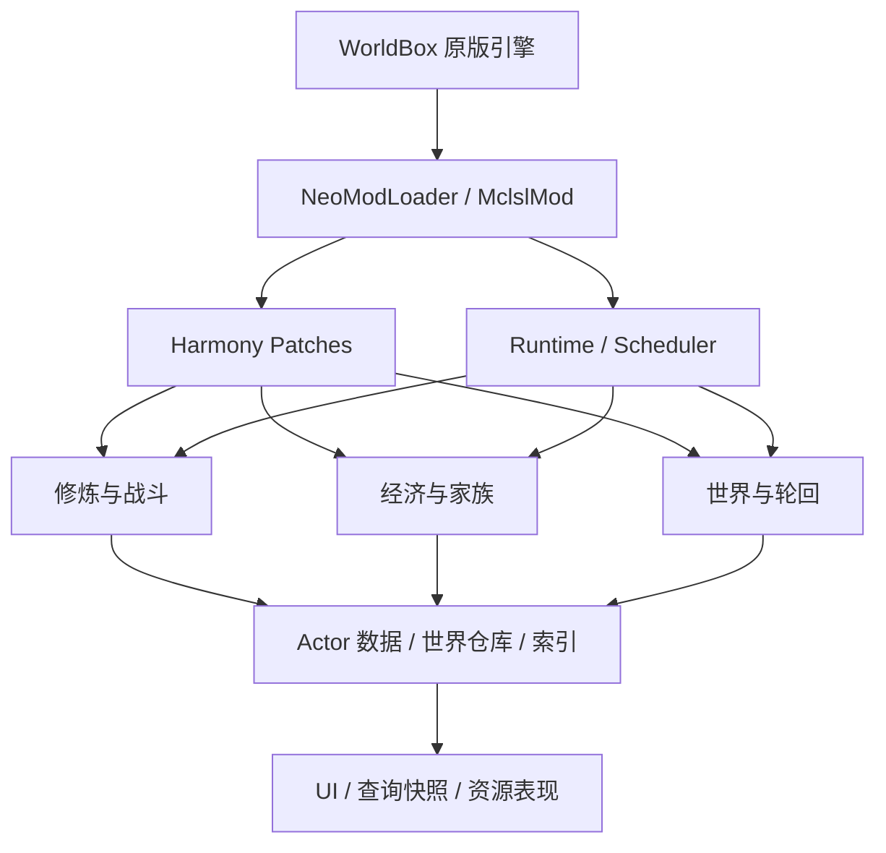


### ⏱️ 判断条件与刷新频率

|功能|主要判断条件|检查/执行频率|时钟口径|暂停与延迟行为|源码|
|---|---|---|---|---|---|
|总入口|NeoModLoader加载此模组|每次进程加载模组时一次|生命周期|不适用|[MclslMod.cs:18](../../MclslMod.cs)|

## 🚀 02 · 启动与进入世界

MclslMod.OnModLoad 先绑定主线程与本地化，再加载配置、注册特质、职业状态、法术状态、妖兽天赋和装备状态，随后注册天地之魄、仙道人物、妖兽、具名人物、玄黄族和契灵，加载图集并挂载 Harmony 补丁，最后初始化运行时及界面。

世界加载不是再次注册所有资源。MclslRuntime.PrepareWorldEntry 清理旧世界运行缓存、绑定 WorldId/Generation、准备阵营染色。TryInitializeCoreWorld 加载世界档案、还真与业务运行状态；FinishWorldEntry 启动地表索引、家族协调、冒泡档案和年度追赶。

关键补丁挂载失败会标记加载失败；世界核心初始化失败会停止模组业务和写入。这里描述已有实现，不新增任何异常处理。

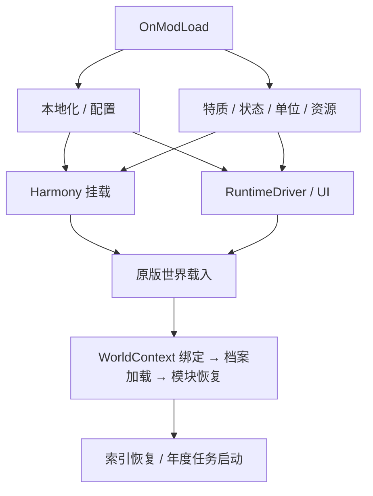


### ⏱️ 判断条件与刷新频率

|功能|主要判断条件|检查/执行频率|时钟口径|暂停与延迟行为|源码|
|---|---|---|---|---|---|
|世界初始化|世界数据存在、核心开启且尚未初始化成功；读档边界重新绑定|世界载入时；初始化未完成时主循环继续尝试|生命周期/帧|初始化和UI不依赖世界年份推进|[MclslRuntime.cs:53](../../code/MySimulatedLongevityRoad/Core/MclslRuntime.cs)|

## ⏱️ 03 · 每帧调度与性能控制

RuntimeDriver 将 Unity 更新接入 MclslRuntime.Tick；同一 Unity 帧只处理一次。显示时钟用 unscaledDeltaTime，并在游戏暂停时冻结，避免特效随世界倍速异常加速。

每帧先建立共享截止时间：正常4ms，年度背压暂停档5ms。优先分配年度工作预算，再处理变更队列、排行更新、玄黄染色与原生帧流；随后处理还真、职业战斗、天地之魄、兽潮、法术、天赋、标记、死亡视觉和公告；最后排出背包待写数据。

这些数值是协作式预算，不是强制抢占：一个尚未返回的同步操作仍可能超时。性能探针按模块记录实际耗时、队列积压和帧状态。

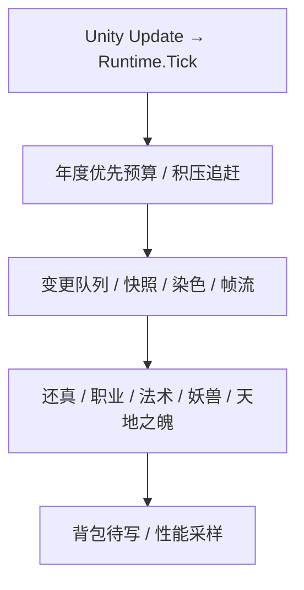


### ⏱️ 判断条件与刷新频率

|功能|主要判断条件|检查/执行频率|时钟口径|暂停与延迟行为|源码|
|---|---|---|---|---|---|
|主循环|同一Unity帧去重；初始化失败或档案写锁会提前退出|每Unity帧最多一次；共享截止时间正常4ms、背压暂停档5ms|帧 / Stopwatch现实耗时|UI、部分缓存和追赶仍可运行，不等于所有模块停摆|[MclslRuntime.cs:156](../../code/MySimulatedLongevityRoad/Core/MclslRuntime.cs)|
|显示时钟|存在世界且World.isPaused()为false|每帧累计unscaledDeltaTime|现实秒累加的DisplayClock|暂停冻结|[MclslRuntime.cs:248](../../code/MySimulatedLongevityRoad/Core/MclslRuntime.cs)|
|年度背压|年度完成年落后世界年；背压开关、补丁和世界绑定有效|主循环检查；年差3/6/10进入对应档；持续超预算12/30秒可辅助降速|世界年差 + unscaled现实时间|背压暂停仍追赶年度；不能把预算当作强制抢占|[MclslAnnualBackpressure.cs:59](../../code/MySimulatedLongevityRoad/Systems/Runtime/MclslAnnualBackpressure.cs)|

## 📅 04 · 年度角色与世界双流程

角色流程由 Scheduler 的候选扫描、首次修炼队列、年度就绪队列和 AnnualActorState 游标推进。每个角色记录活动年、请求年、完成年、阶段和步骤；预算用完保留游标，后续继续。普通妖兽有独立年度修炼捷径。

准备阶段：装备同步、古法师承、自然天资、材料活动、幼年灵根、家族优先援助及常规补给、职业制作、背包整理、自动耗材、年龄修正与仙缘事件。成长阶段：寿元到期、入门、真元增长、古法/新法处理、法术成长、功法冲突与冒险登记。市场阶段分步购买及出售，收尾更新查询投影。

世界流程由 AnnualWorldRuntimeLane 依次处理纪元循环、灾变、洞天、天地变化、天地之魄、逆理、冒险结算、功法道统、宗门、任务、势力压力、家族和兽潮。不是每个模块每年都必定生效，各有纪元与状态门槛。

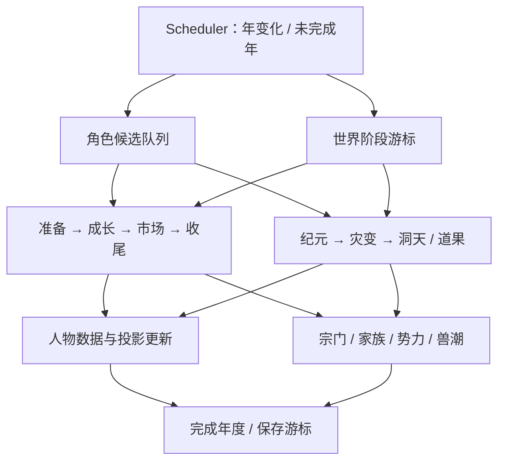


### ⏱️ 判断条件与刷新频率

|功能|主要判断条件|检查/执行频率|时钟口径|暂停与延迟行为|源码|
|---|---|---|---|---|---|
|年度启动与追年|世界年变化，或存在未完成年度且无活动年度；WorldBlocked阻止推进|逐年启动，分帧处理；不是每现实秒固定启动一次|世界年|背压降速/暂停可继续消化已有积压|[MclslScheduler.cs:74](../../code/MySimulatedLongevityRoad/Systems/Runtime/MclslScheduler.cs)|
|角色年度管线|候选人物存活、年度合法；普通妖兽走专用路径；各步骤还有自身门槛|准备→成长→市场→收尾；每个年度步骤按游标推进|世界年 + 帧预算|已请求年度可追赶；无新世界年不凭空重复发收益|[MclslAnnualActorPipeline.cs:19](../../code/MySimulatedLongevityRoad/Systems/Runtime/MclslAnnualActorPipeline.cs)|
|世界年度管线|活动年有效、世界未阻塞且仍有年度预算|每活动年度按阶段推进；一个模块可能跨多帧才完成|世界年 + 帧预算|处理已请求年度；不是每帧重跑一整年|[MclslAnnualWorldRuntimeLane.cs:73](../../code/MySimulatedLongevityRoad/Systems/Runtime/MclslAnnualWorldRuntimeLane.cs)|

## 🧬 05 · 人物身份、索引与变更传播

ActorRegistry 管理已知人物及按ID解析；CultivatorCandidateIndex 提供修炼和年度候选；ActorProjectionIndex 维护用途投影；WorldActorQuery 提供已跟踪人物视图。它们是运行索引，不是独立存档真值。

ActorAccessor 集中读取、设置人物自定义数据，涵盖境界、灵根、心境、功法和资源字段。RuntimeChanges 传递人物变化标记，驱动相关索引、缓存与界面失效。ActorSelection 把选人工作分批推进，降低一次扫描全世界的成本。

原版国家、城市、家族关系与模组的宗门、组织、修炼道统属于不同概念；仅当具体业务需要时映射，不能把这些身份混作同一张关系表。

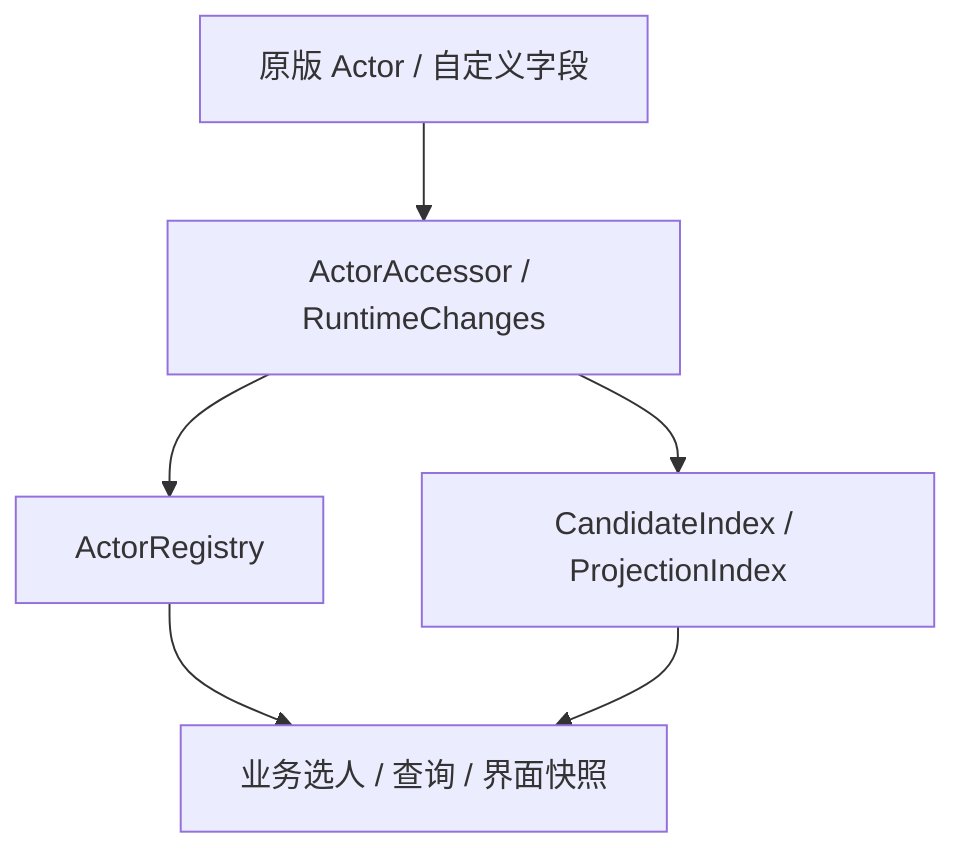


### ⏱️ 判断条件与刷新频率

|功能|主要判断条件|检查/执行频率|时钟口径|暂停与延迟行为|源码|
|---|---|---|---|---|---|
|身份登记与索引失效|出生、载入、字段变化、死亡或业务显式登记|事件/变更队列驱动；Runtime每帧尝试Drain|事件 + 帧预算|队列可处理；具体业务仍受各自门槛约束|[MclslRuntime.cs:204](../../code/MySimulatedLongevityRoad/Core/MclslRuntime.cs)|

## 🧘 06 · 灵根、感气与双修炼体系

SpiritualRootSystem、ChildhoodRootSystem、SpiritualRootEntrySystem 处理灵根身份、幼年阶段检查和天资入门；SensingQiSystem 处理未正式入境界时的感气。MindSystem 与 MortalFateEventSystem 提供心境、炼心、洗瘴和仙缘相关入口。

AnnualCultivationExecutor / CultivationGrowthSystem 执行年度真元增长；CultivationStateTransitions 管理体系与境界变化，避免不同入口各自改一套字段。AncientLawSystem / AncientLawBreakthroughSystem 负责旧法；CultivationSystem / NewLawBreakthroughSystem 负责新法及突破资源条件。

新法突破与筑基奇物、金丹法则、元婴洞天及天地之精、化神天地之髓、合道天地之魄、长生逆理等世界成果相连。RealmSeatSystem、LongevityRules、年龄修正和功法上限一起限制进度；并非仅把经验条加满便能无限升级。

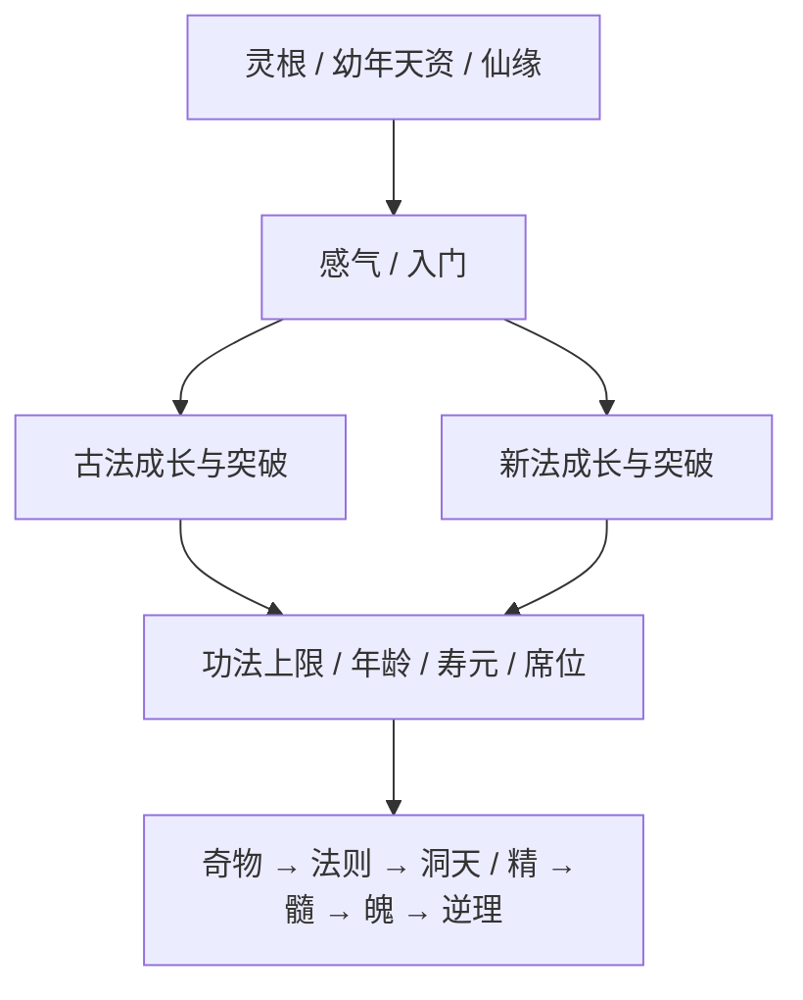


### ⏱️ 判断条件与刷新频率

|功能|主要判断条件|检查/执行频率|时钟口径|暂停与延迟行为|源码|
|---|---|---|---|---|---|
|灵根、幼年入门、自然天资|N/R按存活、5岁以上、智慧、可修炼且非全部妖兽统计；专用RootPopulation位仅在实际灵根/智慧资格/登记/年龄门槛变化唤醒，普通功法职业资源变化不复查|登记一次、精确事件增量更新；每年原人口扫描分帧校正；稳定排序批次每调用最多32且受共享预算；候选集中读取资格，赋予后即时计数；总览文本只在数据变动重建|生命周期/变更事件 + 世界年；读档重建就绪后才分配|不主动推进年龄；可分帧完成已收集候选；无成年人补领|[MclslChildhoodRootSystem.cs:67](../../code/MySimulatedLongevityRoad/Systems/Cultivation/MclslChildhoodRootSystem.cs)|
|寿元、真元增长、感气与突破|存活、年度执行作用域有效；有无境界决定感气或正式修炼；按古法/新法分流|年度成长步骤；记录上次修炼年限制重复结算|世界年|可补算欠账年度；暂停本身不增加修炼年份|[MclslAnnualActorPipeline.cs:84](../../code/MySimulatedLongevityRoad/Systems/Runtime/MclslAnnualActorPipeline.cs)|
|突破条件|真元/年龄/功法的原有前置门槛保留；只缓存确定性功法上限失败，人物DataRevision变化失效|年度增长及随机机会不减少；同数据版本同目标的重复失败检查复用结果|世界年 / 业务事件（优化后见频率栏）|界面刷新不会重复突破；具体主动命令另看业务限制|[MclslTechniqueRealmLimit.cs:128](../../code/MySimulatedLongevityRoad/Systems/Cultivation/MclslTechniqueRealmLimit.cs)|

## 🌗 07 · 旧法转新法与世界纪元

WorldEpochSystem 维护古法、传法过渡及新法时代相关状态，和 TimelineSystem、NewLawPioneerSystem、世界仓库共同组织传法事件与纪元变迁。

转法不是在某一年一次性重写所有人物：现有实现包含种子推进、转换候选与过渡工作预算，Scheduler 将过渡工作视为待处理负载。人物体系转换经状态转换与修炼逻辑继续处理，相关索引和展示随变更更新。

源码中可见过渡种子预算12、转换预算6及0.45ms工作预算。它们不能证明新法时代的全部性能问题已经解决；需要运行探针区分转换、角色年度、世界年度、资源流和UI成本。

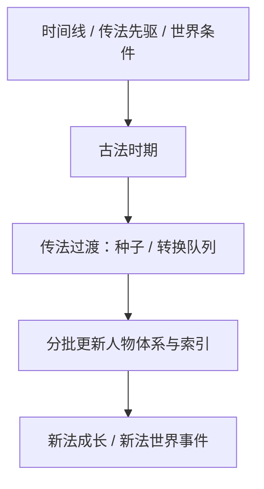


### ⏱️ 判断条件与刷新频率

|功能|主要判断条件|检查/执行频率|时钟口径|暂停与延迟行为|源码|
|---|---|---|---|---|---|
|旧法转新法|同世界代次同Unity帧一次；有效与无效记录都计预算；新增候选通过变更通知入队并去重|每批最多检查12个种子、取6条转换记录，双方共用0.45ms起点并同时遵守年度/总帧预算|帧预算 / 世界纪元（优化后见频率栏）|已有过渡工作可继续；是否新增年度由调度决定|[MclslWorldEpochSystem.cs:257](../../code/MySimulatedLongevityRoad/Systems/WorldResources/MclslWorldEpochSystem.cs)|

## 📜 08 · 功法、师承与道统

TechniqueStageSystem、TechniqueRealmLimit 组织功法修炼阶段及境界上限；TechniqueLineageSystem 维护法脉、分支与年度传承；AncientMentorshipSystem 处理古法师徒和招收学生。

TechniqueOccupationSystem 把同法争夺、冲突年度处理、击杀观察和死亡释放串联起来。家族具有功法传承与库存供给路径；FactionExchangeSystem 提供功法兑换等势力资源入口。

功法数据影响能否继续突破，法则/根基影响世界资源竞争；传承的变化会写入人物、道统记录和纪事，供玄黄仙录及人物界面读取。

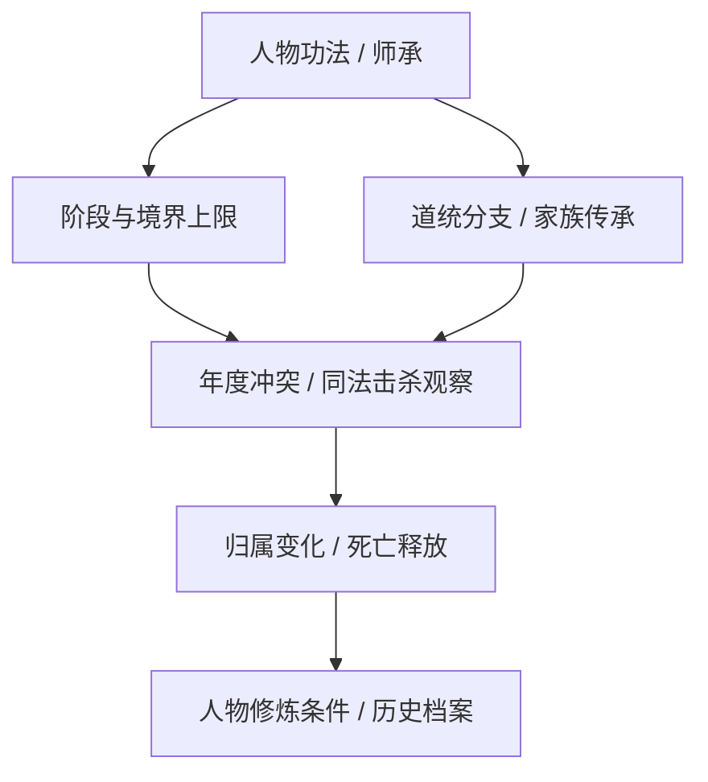


### ⏱️ 判断条件与刷新频率

|功能|主要判断条件|检查/执行频率|时钟口径|暂停与延迟行为|源码|
|---|---|---|---|---|---|
|师承与功法成长|现有10年招徒/传授门槛不变；传授到期判断移到学生列表构建之前|年度机会与书籍成长保留；未到传授年不构建传授学生列表|世界年 / 事件（优化后见频率栏）|无新年份不新增年度成长；事件只在真实发生时处理|[MclslAnnualActorPipeline.cs:140](../../code/MySimulatedLongevityRoad/Systems/Runtime/MclslAnnualActorPipeline.cs)|
|道统年度结算|世界年度到道统阶段；按当前传承数据与候选处理|每活动年度，预算不足跨帧续做|世界年 / 帧预算|可能继续结算已请求年度|[MclslAnnualWorldRuntimeLane.cs:172](../../code/MySimulatedLongevityRoad/Systems/Runtime/MclslAnnualWorldRuntimeLane.cs)|

## ⚔️ 09 · 六大战斗职业

CombatCareerCatalog 定义剑修、武修、术修、符修、阵修、灵契师，以及五阶主动/被动技能、消耗、冷却和熟练成长门槛。CombatCareerSystem 管职业身份和成长；CareerCombat 管活跃战斗状态、施法、区域、标记、护持和结算；CareerSupply 管职业物资制作。

战斗补丁将原版攻击、受击和死亡事件接入职业逻辑；职业伤害同时依赖境界压制、体质、目标关系及技能条件。CareerBattleState 保存施法、区域、契灵、标记等运行状态，Persistence / StateValidation 处理存读档和时间重定位。

符修和阵修部分高阶技能消耗对应物品；职业与炼丹、炼器、制符等生产职业是两套职责，不应混同。

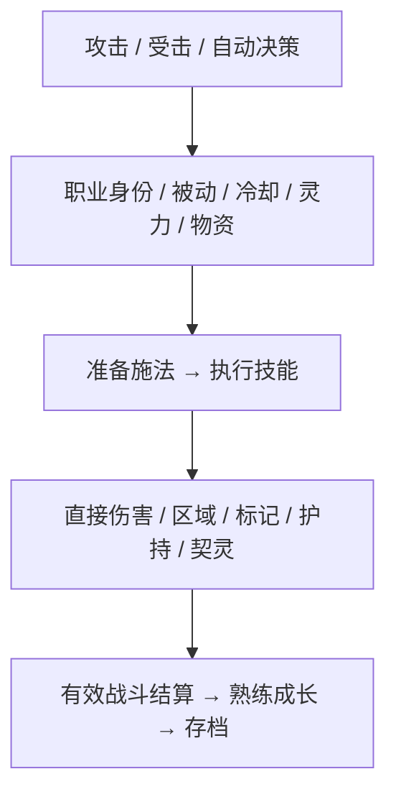


### ⏱️ 判断条件与刷新频率

|功能|主要判断条件|检查/执行频率|时钟口径|暂停与延迟行为|源码|
|---|---|---|---|---|---|
|职业活跃人物维护|保留现有活跃集合/目标唤醒；无目标且主人与宠物均满血时灵契师跳过完整主动决策|战斗中0.25秒不变；非灵契职业与普通妖兽沿用既有休眠路径|帧 + 世界时间（优化后见频率栏）|Config.paused时职业Tick直接返回|[MclslCareerCombat.cs:247](../../code/MySimulatedLongevityRoad/Systems/Combat/MclslCareerCombat.cs)|
|职业自动施法决策|敌人/灵力/阶位/冷却/道具保持原门槛；无需求的灵契主动决策提前退出|战斗中每人物最短0.25世界时间秒不变|世界时间Now（优化后见频率栏）|世界时间冻结且职业暂停门槛生效时不施法|[MclslCareerCombat.cs:283](../../code/MySimulatedLongevityRoad/Systems/Combat/MclslCareerCombat.cs)|
|职业主动技能与被动反馈|满足对应技能条件；命中/受击时执行相关被动|主动基础冷却按阶8/12/18/26/40世界时间秒；被动特效另有0.5秒节流|世界时间 / 攻击受击事件|状态时间随世界时钟；不按现实秒强制结算|[MclslCombatCareerCatalog.cs:25](../../code/MySimulatedLongevityRoad/Data/MclslCombatCareerCatalog.cs)|

## 🐾 10 · 灵契师单宠与双向关系

绑定职业后选择灵狼、岩龟、雷隼或灵鹿中的一种。CareerContract 维护永久契灵、类型选择、主人—宠物关联、属性随主人成长、攻击/治疗节拍与死亡重召冷却。ContractRules 提供可独立测试的规则。

存活契灵不会因临时召唤时长结束而消失；死亡后先进入冷却，再满足灵力和召唤条件时补充。旧多宠记录有选择保留一只的迁移路径。契灵攻击目标沿用主人敌我判断，具体远程和治疗效果由契约业务结算。

ContractInfoBar 查询关系，仅显示契约灵宠姓名或主人姓名及境界，并允许跳转。四种契灵当前资源各含4帧待机、8帧移动；图集切帧与职业动画数组共同决定实际播放。

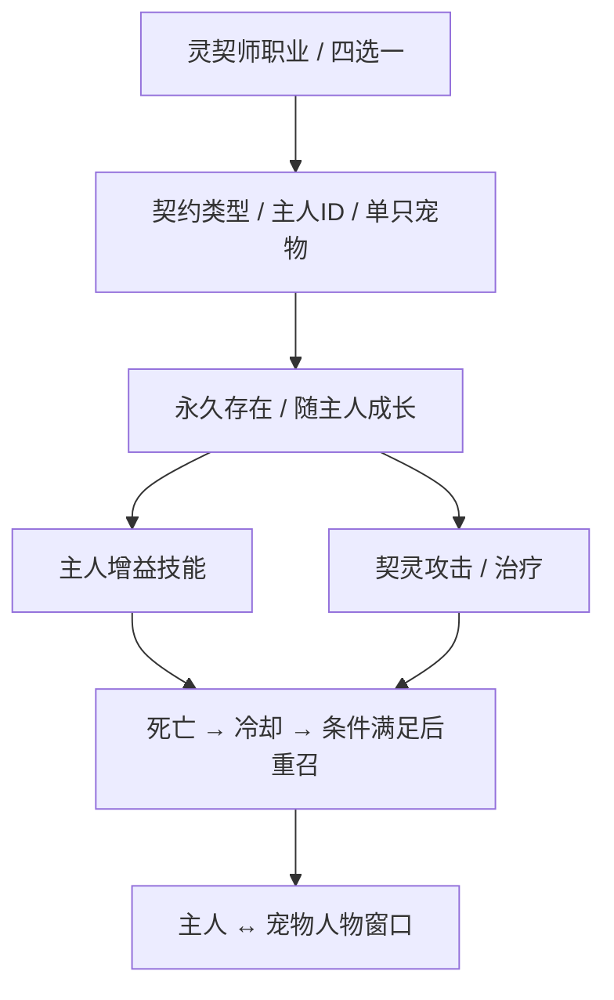


### ⏱️ 判断条件与刷新频率

|功能|主要判断条件|检查/执行频率|时钟口径|暂停与延迟行为|源码|
|---|---|---|---|---|---|
|契灵属性与跟随战斗更新|绑定宠物存活；战斗或主人/宠物受伤时保持活动；主人属性/目标变化提前唤醒|活动1世界时间秒；满状态脱战3秒；生命/攻击未变化时不重写属性与生命比例|世界时间Now|受职业Tick暂停门槛约束|[MclslCareerContract.cs:92](../../code/MySimulatedLongevityRoad/Systems/Combat/MclslCareerContract.cs)|
|雷隼攻击、灵鹿治疗|更新宠物时检查NextAttack/NextHeal及敌人/受益者等条件|雷隼最短2秒、灵鹿最短6秒、协击冷却6秒；均为世界时间秒|世界时间Now|不保证现实2/6秒；预算和目标条件可能延迟|[MclslContractRules.cs:28](../../code/MySimulatedLongevityRoad/Systems/Combat/MclslContractRules.cs)|
|宠物死亡重召|死亡确认后写NextSummonAt；冷却到期、已选类型、灵力等条件满足|死亡冷却30世界时间秒；之后在职业调度中尝试；存活不重复召唤|事件 + 世界时间|暂停时世界时间不走，冷却通常不推进|[MclslContractRules.cs:10](../../code/MySimulatedLongevityRoad/Systems/Combat/MclslContractRules.cs)|
|宠物待机/移动显示|原版请求Sprite；isAlive和is_moving选状态；切状态重置动画起点|待机0.18显示秒/帧、4帧；移动0.12显示秒/帧、8帧|DisplayClock|暂停冻结；按当前时间取帧，低FPS可能跳过显示帧|[MclslCareerCombat.cs:67](../../code/MySimulatedLongevityRoad/Systems/Combat/MclslCareerCombat.cs)|

## ✨ 11 · 通用法术、神通与阶段动画

SpellSystem 管学习、已知法术缓存、灵力、冷却、主动攻击与自身辅助施法入口；SpellProgression 管成长；SpellCasting 管分阶段与延迟执行，SpellSupportStage 接入辅助法术的施法→生效表现。

26种法术中，原有16种阶段资源与后来10种辅助法术阶段资源共同构成当前图集方案。10种辅助包括青木回春、水镜护身、厚土壁、御风行、咫尺遁光、纳灵术、灵泉归元、山岳护体、五行化生和万灵回天；辅助默认施法0.24秒、生效0.72秒，保持数值结算入口。

万灵回天把生效动画绑定到实际治疗受益者，并受目标上限和敌我、存活等过滤。妖兽天赋与普通修士法术是不同入口，不能因共享特效就认为共享全部技能规则。

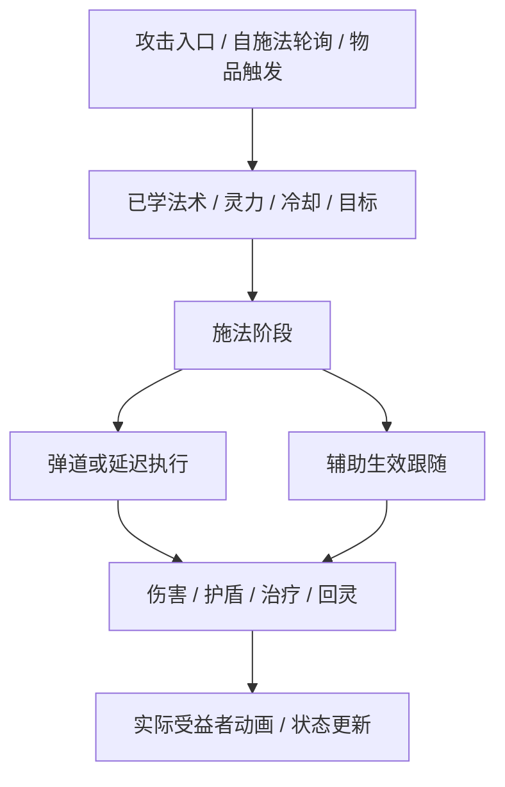


### ⏱️ 判断条件与刷新频率

|功能|主要判断条件|检查/执行频率|时钟口径|暂停与延迟行为|源码|
|---|---|---|---|---|---|
|脱战辅助法术轮询|世界时间前进、每20核心帧最多64人；人物存活且无攻击目标；状态变化提前检查|满状态稳定候选最迟3世界时间秒资格复查；施法成功允许下轮再判断；未到期辅助冷却可安排更早检查|帧 + 世界时间前进门槛（优化后见频率栏）|源码显式阻止世界时间未前进时施法|[MclslSpellSystem.cs:391](../../code/MySimulatedLongevityRoad/Systems/Cultivation/MclslSpellSystem.cs)|
|战斗法术判断|攻击入口触发；已知法术、灵力、冷却和目标条件满足；妖兽分流天赋|攻击事件驱动；各法术冷却由目录数据决定，无统一固定间隔|攻击事件 / 世界时间Now|不因打开界面重复触发|[MclslSpellSystem.cs:549](../../code/MySimulatedLongevityRoad/Systems/Cultivation/MclslSpellSystem.cs)|
|施法阶段和辅助生效动画|存在待执行施法/活跃效果；阶段到期或时间进度改变|主循环推进待执行任务；辅助阶段默认0.24秒施法、0.72秒生效，不代表扫描间隔|业务世界时间 / 视觉DisplayClock分别计算|展示时钟冻结；不能把视觉持续时间当成技能冷却|[MclslSpellSupportStage.cs:25](../../code/MySimulatedLongevityRoad/Systems/Cultivation/MclslSpellSupportStage.cs)|

## 🎒 12 · 背包、货币与生产经济

ItemEconomy.cs 内含 BagSystem 和生产职业等多个类型。背包用物品定义ID和实例/堆叠记录表示物品，读缓存和计数索引减少重复解析。年度业务使用背包事务，多次变更合并为待写，保存前强制刷新。

生产职业根据已知配方、品阶、材料和年度制作限制选择产物；配方先解析一次，再扣材料，保留已有失败回滚。ArtifactEquipmentSystem 管装备槽和状态；ItemUseSystem 管自动耗材与持续效果；MaterialDiscovery、SpellScrollCrafting、MentorshipGiftSystem 管获得来源。

灵石与贡献度通过现有经济接口及账本/人物资源字段流转，属性显示复用实际余额，不依赖文本框自己维护另一份数字。资源可用于购买、兑换和修炼供给，变更影响背包与UI。

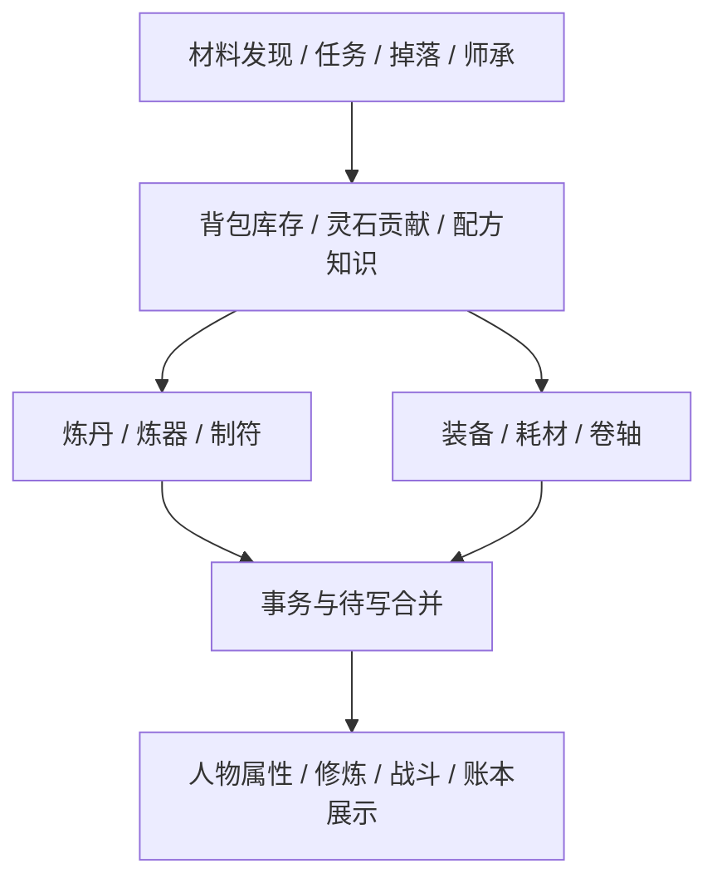


### ⏱️ 判断条件与刷新频率

|功能|主要判断条件|检查/执行频率|时钟口径|暂停与延迟行为|源码|
|---|---|---|---|---|---|
|生产职业、材料活动与自动耗材|职业等级/已知配方/材料/年度制作限制；耗材存量和可用状态|年度准备步骤；无适用任务的步骤会跳过；手动物品使用另为事件|世界年 / 使用事件|已请求年度可补结算；不会每界面刷新制作一次|[MclslAnnualActorPipeline.cs:162](../../code/MySimulatedLongevityRoad/Systems/Runtime/MclslAnnualActorPipeline.cs)|
|背包写回与余额展示|沿用现有去重队列和事务，空队列立即返回；保存前仍强制刷新|每帧最多8项且受预算限制，不增加写回延迟|变更事件 + 帧 / 保存事件（优化后见频率栏）|写回可发生，写锁等既有条件仍有效；展示刷新不造收益|[MclslItemEconomy.cs:117](../../code/MySimulatedLongevityRoad/Systems/Crafting/MclslItemEconomy.cs)|

## 🪞 13 · 天玄镜市场与家族补给

TianxuanMarket 按人物需求分批购买并处理多余物资出售、待发布列表和清理。AnnualEconomyPlan 在同一次年度操作中复用保留量与需求计划，减少背包重复扫描。

家族优先援助会先处理重点成员，再执行常规家族供给；随后生产职业制作，市场阶段补缺和出售剩余。家族库存、个人背包和市场库存是不同所有权的库存，不能重复计算为人物资产。

FamilySystem 按 partial 文件拆分父系、库存、补给、功法、视图和读档协调；拆分文件不代表多份家族逻辑。

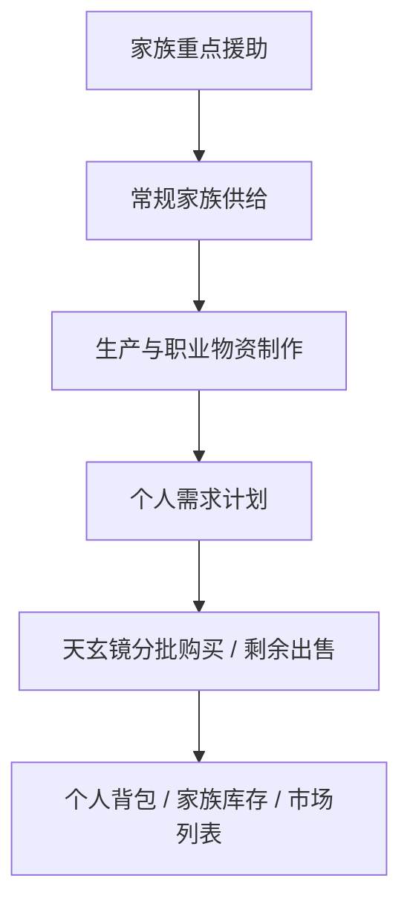


### ⏱️ 判断条件与刷新频率

|功能|主要判断条件|检查/执行频率|时钟口径|暂停与延迟行为|源码|
|---|---|---|---|---|---|
|家族援助与供给|重点成员援助先于常规供给；家庭库存、成员资格和当前需求满足|年度准备步骤；预算不足保留当前步骤继续|世界年 / 帧预算|可追赶已有年度，不是每秒全家重新分配|[MclslAnnualActorPipeline.cs:52](../../code/MySimulatedLongevityRoad/Systems/Runtime/MclslAnnualActorPipeline.cs)|
|天玄镜需求购买/剩余出售|人物已有境界；购买批次未完成则保留Market步骤0；完成后再出售|每角色年度Market阶段分批执行|世界年 / 帧预算|暂停可处理欠账批次；不保证一次调用购齐|[MclslAnnualActorPipeline.cs:87](../../code/MySimulatedLongevityRoad/Systems/Runtime/MclslAnnualActorPipeline.cs)|
|待售物品发布|存在待发布队列；两处入口都受自己的调用环境限制|RuntimeCadence每30核心帧最多8条；年度世界准备也有发布入口|帧 / 年度阶段|不应解读为每现实0.5秒精确发布|[MclslRuntimeCadence.cs:38](../../code/MySimulatedLongevityRoad/Systems/Runtime/MclslRuntimeCadence.cs)|

## 🏯 14 · 宗门、势力、遗迹与家族关系

SectLifecycleSystem 处理宗门年度生命周期；FactionMissionSystem 处理势力委托与奖励；FactionPressureSystem 处理势力压力；FactionExchangeSystem 处理兑换。AdventureSystem 汇总年度探索并结算遗迹事件。

世界仓库记录宗门、遗迹、探索、道统、压力等世界对象；人物保存自身归属与资源。完成探索或任务可影响灵石、贡献、材料、功法、根基线索与历史记录；后续又影响修炼、装备和势力互动。

妖兽应经身份判定排除宗门/组织候选；世界野生归属与宗门排除是两层规则。文档将其记录为业务路径存在，不据此宣称所有旧存档场景已游戏内验收。

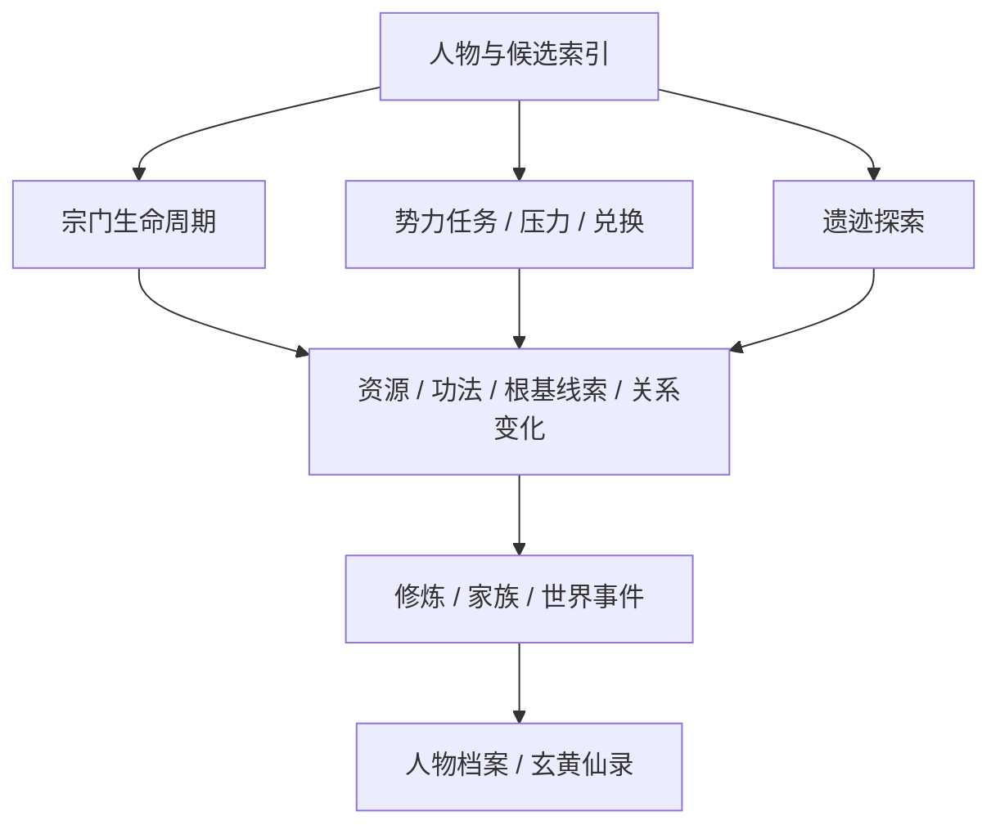


### ⏱️ 判断条件与刷新频率

|功能|主要判断条件|检查/执行频率|时钟口径|暂停与延迟行为|源码|
|---|---|---|---|---|---|
|宗门生命周期、势力任务/压力|各自年度阶段到达；压力另外要求新法；妖兽候选排除在业务中执行|每活动年度；宗门可跨帧结算；兑换/放置为玩家事件|世界年 / 交互事件|只有年度请求或操作触发，不是每帧重选归属|[MclslAnnualWorldRuntimeLane.cs:177](../../code/MySimulatedLongevityRoad/Systems/Runtime/MclslAnnualWorldRuntimeLane.cs)|
|遗迹探索登记和结算|角色已有境界时登记年度冒险；世界冒险阶段处理结果|角色年度登记→世界年度统一分批结算|世界年 / 帧预算|积压会推迟显示结果，界面刷新不会加快游戏年|[MclslAnnualActorPipeline.cs:221](../../code/MySimulatedLongevityRoad/Systems/Runtime/MclslAnnualActorPipeline.cs)|

## 🌍 15 · 世界资源、灾变与高阶道果

GeneratedObjectFactory 生成筑基奇物、天地之精、髓等记录；WorldCaveSystem 处理洞天与争夺；WorldChangeSystem 处理天地变化及死亡观察；WorldCalamitySystem、WorldEraCycleSystem 处理世界层面事件。

WorldSoulSystem 按显化、持有、祭炼/职责、死亡释放等路径维护天地之魄，实体由 WorldSoulActorRegistration 注册，分离攻击和地形效果；InverseTruthSystem 管逆理；TaishangSystem 管长生后的进一步进展。

这些模块与人物突破不是独立迷你游戏：它们改变人物根基、法则、道果、寿元与归属，死亡又把部分世界资源释放回世界，形成获取—持有—释放循环。

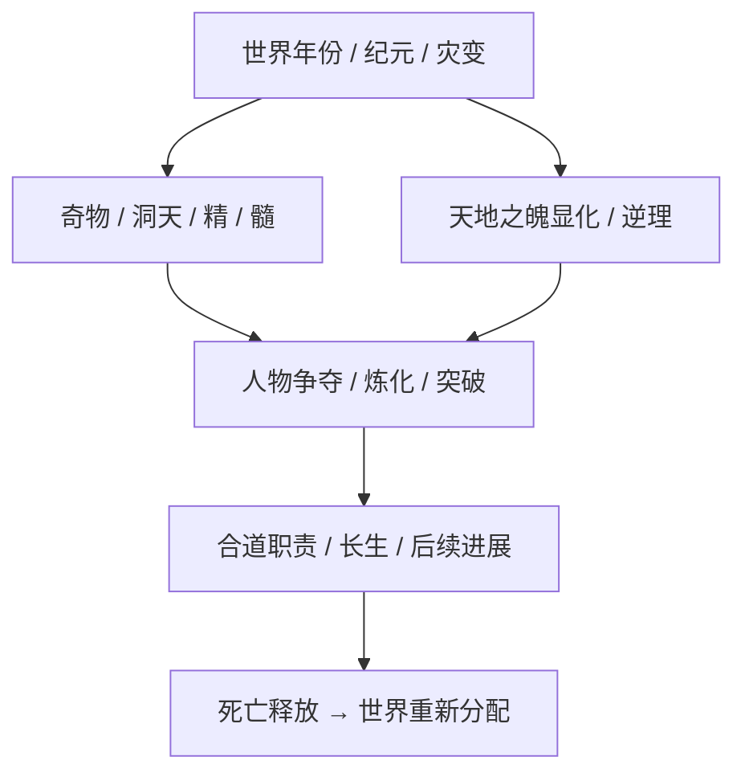


### ⏱️ 判断条件与刷新频率

|功能|主要判断条件|检查/执行频率|时钟口径|暂停与延迟行为|源码|
|---|---|---|---|---|---|
|纪元循环、灾变、洞天、天地变化、逆理|年度对应阶段；洞天等要求新法资源可用；到Next…Year且未超活动数量等门槛|每年判断，但生成/事件按各自到期年份、数量和世界修正条件；无统一固定生成周期|世界年|无新世界年不因现实等待自动生成；欠账年度可续做|[MclslAnnualWorldRuntimeLane.cs:141](../../code/MySimulatedLongevityRoad/Systems/Runtime/MclslAnnualWorldRuntimeLane.cs)|
|天地之魄实体帧维护|区分搜索轮次启动与已在推进的遍历；死亡/伤害事件不降频|无活动遍历时每12核心帧启动一轮；已开始轮次继续跨帧推进|帧 / 世界年（优化后见频率栏）|帧维护与年度效果不能混为一类|[MclslWorldSoulSystem.cs:143](../../code/MySimulatedLongevityRoad/Systems/WorldSoul/MclslWorldSoulSystem.cs)|
|天地之魄重显化|释放/身死等路径写入NextManifestYear；后续年度判断到期和可用条件|相关路径为当前年+70+(稳定哈希%81)，即70～150世界年；非每种显化入口统一如此|世界年|暂停不增加显化年份|[MclslWorldSoulSystem.cs:227](../../code/MySimulatedLongevityRoad/Systems/WorldSoul/MclslWorldSoulSystem.cs)|

## 🐉 16 · 妖兽、兽潮、修炼与掉落

BeastActorRegistration、BeastCatalog / Content / Rules 定义普通、具名及化形相关单位。BeastCultivation 管普通妖兽年度成长；BeastTalentSystem 管天赋、目标、持续状态和相关保存；BeastLoot 处理死亡掉落。

当前 BeastSpawnSystem 仅保留地表匹配辅助，年度兽潮由 WorldRuntimeLane 刷新地表后调用 BeastWorld.TickAnnual。BeastWorld 管兽潮请求、进度和运行状态，PopulationIndex / SurfaceIndex 分别提供存量和海陆地表信息。手动放置由生灵目录入口发起。

普通自然随机生成机制已退出主流程，保留自动兽潮、手动召潮和目录放置。动物AI继承原版模板并配置战斗行为；妖兽神通走模组结算。

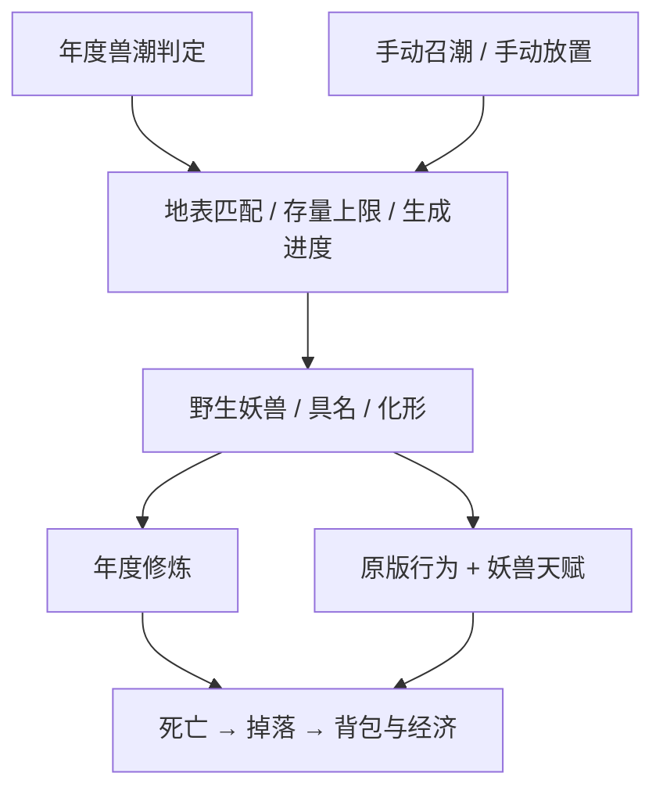


### ⏱️ 判断条件与刷新频率

|功能|主要判断条件|检查/执行频率|时钟口径|暂停与延迟行为|源码|
|---|---|---|---|---|---|
|自动兽潮年度判定|Enabled、未锁定、年份有效、该年未处理且year%Interval==0|每年检查；Interval代码初始值5年，可被配置覆盖；并非每5现实秒|世界年 / 配置|未有新年不新增年度潮次；手动召潮为独立请求|[MclslBeastWorld.cs:129](../../code/MySimulatedLongevityRoad/Systems/Beasts/MclslBeastWorld.cs)|
|兽潮分批生成|世界单位存在、未锁定、未Config.paused；Time.time到_nextSpawnTime；波次为生成中且未超存量|最短0.15 Unity缩放秒一批；每批最多2只且批内耗时小于2ms|Unity Time.time + 现实耗时预算|显式Config.paused停止生成；不能把Time.time等同世界年或DisplayClock|[MclslBeastWorld.cs:241](../../code/MySimulatedLongevityRoad/Systems/Beasts/MclslBeastWorld.cs)|
|地表匹配与存量维护|地图就绪、尺寸有效；地表索引未完成或有变更；存量做部分校验|地表每次最多min(2ms,剩余帧预算,可选年度剩余预算)；兽潮Tick校验最多8条存量记录|事件/帧 + 预算|手动召潮先准备地表，实际生成仍遵守暂停门槛|[MclslBeastSurfaceIndex.cs:112](../../code/MySimulatedLongevityRoad/Systems/Beasts/MclslBeastSurfaceIndex.cs)|
|妖兽天赋施法决策|模块Ready、世界/暂停/帧预算门槛、活跃妖兽到Decision且技能可用|每被轮到妖兽最短0.5世界时间秒一次决策；命中和状态到期另行处理|世界时间Now / 事件|冻结与预算限制可能推迟实际施放|[MclslBeastTalentSystem.cs:472](../../code/MySimulatedLongevityRoad/Systems/Beasts/MclslBeastTalentSystem.cs)|

## 👤 17 · 玄黄族、文明与资源表现

XuanhuangRegistration 克隆原版人类文明资产，注册种族、建筑体系、码头和三类船只，保留原版城市生产与船只行为。船只沿用原版方向绘制委托；建筑与船显示尺寸在资产层配置。

XuanhuangDirectionPatch 管侧/正/背方向、年龄性别及职业外观、阵营染色和帧数据；有角色缓存、分色队列和着色图集。完整人物已自带头部，独立原版头部被关闭。

最新头像适配补丁只处理玄黄族的 UnitAvatarLoader 动画/静态入口，读取152帧可见范围并固定缩放居中，地图体型不受影响。LivingResources 清单负责图集矩形、枢轴和PPU；BeastAnimation / NativeActorFrames 管其他单位帧播放、缓存及流式加载；世界特效层负责护盾、光环、标记和死亡表现。

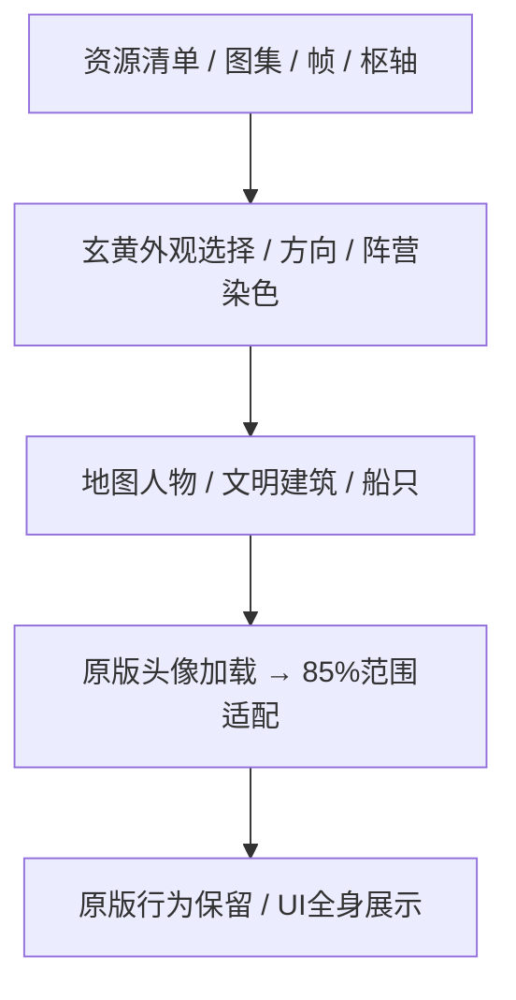


### ⏱️ 判断条件与刷新频率

|功能|主要判断条件|检查/执行频率|时钟口径|暂停与延迟行为|源码|
|---|---|---|---|---|---|
|玄黄人物方向与染色|原版请求主Sprite/帧数据；按外观、移动方向及颜色变化命中或失效缓存|渲染事件驱动；染色队列由Runtime每帧尝试推进|渲染帧 / 缓存失效|暂停时可以显示/准备缓存，不代表业务年推进|[MclslXuanhuangDirectionPatch.cs:21](../../code/MySimulatedLongevityRoad/Patches/MclslXuanhuangDirectionPatch.cs)|
|头像全身适配|UnitAvatarLoader完成showAnimation/showStatic且人物资产为玄黄族|头像显示/重算时；152帧共同边界首次算后缓存，不是每帧读全部图集|UI事件 / 缓存|暂停仍能切人、显示头像|[MclslXuanhuangDirectionPatch.cs:86](../../code/MySimulatedLongevityRoad/Patches/MclslXuanhuangDirectionPatch.cs)|
|船只尺寸保持|Actor.updateStats后，is_boat且玄黄船ID前缀匹配|属性刷新事件后恢复配置scale、target_scale和当前scale；非全图每帧扫描|原版属性刷新事件|是否触发取决于原版属性刷新，不依赖新世界年|[MclslXuanhuangDirectionPatch.cs:76](../../code/MySimulatedLongevityRoad/Patches/MclslXuanhuangDirectionPatch.cs)|
|境界光环和地图标记|光环资格变化使可见扫描失效；标记数据版本/年份变化或待协调立即处理|光环近景15帧/远景LOD30帧；压力档取较慢值；标记120帧兜底、未完成逐帧续做；动画频率不变|帧 + DisplayClock（优化后见频率栏）|数据协调仍可运行；显示时钟暂停冻结光环动画|[MclslRealmHaloVisualSystem.cs:87](../../code/MySimulatedLongevityRoad/Systems/Visual/MclslRealmHaloVisualSystem.cs)|

## 💀 18 · 死亡、转世、还真和冒泡

DeathEventRouter 把一次已提交死亡依次转交击杀统计、还真击杀观察、同法争夺、凡浊、天地变化、天地之魄死亡、修士死亡、持有者释放、功法释放、还真死亡、家族、妖兽掉落和职业契灵清理。不同业务关注同一死亡，不等于重复杀死单位。

ActorReincarnationSystem / ReincarnationService / ProfileStore 是转世相关通路；HuanzhenSystem 是保存锚点、回溯世界、跨回溯保留灵蕴与前世遗产的另一套机制。MaobaoSystem / ArchiveManager / Snapshot 是人物档案与再放置相关功能，也不能与世界回溯混称。

还真自动寻主要求原版智慧且排除妖兽；最新一次轮盘替换旧轮盘，最多自动继承3项，按修为、功法、高阶道果、特质及资源的优先级顺延。既有领取占名额；领取沿用持久化与具体恢复入口。

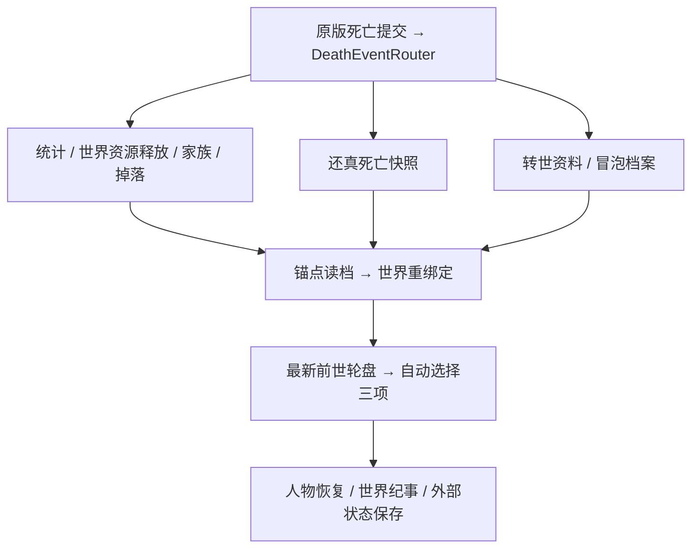


### ⏱️ 判断条件与刷新频率

|功能|主要判断条件|检查/执行频率|时钟口径|暂停与延迟行为|源码|
|---|---|---|---|---|---|
|死亡分发、掉落与契灵丢失|原版死亡已确认后进入DeathEventRouter，各领域按身份和状态判断|真实死亡事件一次按领域分发；不是每帧把活人遍历一遍|死亡事件|暂停无新死亡则不新增；已提交事件按实际入口执行|[MclslDeathEventRouter.cs:22](../../code/MySimulatedLongevityRoad/Systems/Death/MclslDeathEventRouter.cs)|
|还真最新遗产自动领取|每60 Unity帧；不在回溯加载/待恢复中；最新轮盘未满3项、存在宿主、写入未锁；跳过已领/不可用项|每60渲染帧检查；满3项直接退出；不是固定现实1秒|帧 / 数据状态|该入口无独立Config.paused限制，暂停中仍可能自动领取|[MclslHuanzhenSystem.cs:108](../../code/MySimulatedLongevityRoad/Systems/Reincarnation/MclslHuanzhenSystem.cs)|
|还真自动寻主|启用还真、没有宿主、纪元与到期年份满足；智慧且非妖兽并符合现有修炼/灵根要求|年度触发/未完成选人逐帧续做；初次延后5～20世界年，失败重试延后5年|世界年 + 分批候选|无新年不越过到期年份；已经启动的选人工作可续做|[MclslHuanzhenSystem.cs:216](../../code/MySimulatedLongevityRoad/Systems/Reincarnation/MclslHuanzhenSystem.cs)|
|还真自动锚点与灵蕴|自动锚点达到配置间隔且宿主/状态满足；请求后等待负载安静或既有恢复条件；灵蕴到期结算|锚点间隔由HuanzhenAnchorIntervalYears配置；等待恢复门槛20现实秒；自然灵蕴10世界年一期|世界年 / unscaled现实秒|暂停不会新增世界年；排队请求与现实等待可能继续|[MclslHuanzhenSystem.cs:22](../../code/MySimulatedLongevityRoad/Systems/Reincarnation/MclslHuanzhenSystem.cs)|

## 💾 19 · 存档真值与缓存边界

第一层：原版世界与人物自定义数据保存角色字段、模组世界身份、部分序列化运行状态。第二层：WorldRunRepository 和 WorldArchiveStore 管世界档案、纪事、生成对象、道统、宗门、家族及年度批次。第三层：StorageRoot 下的 HuanzhenState.json、HuanzhenAnchors 和 ReincarnationProfile.json 管跨还真/跨世界所需资料。

当前发行版本为0.8.6，但 WorldContext.Version 与 SavePrefix 仍使用0.8.0 / mclsl.080.，这是源码中的存储命名版本，不应把目录改名当作升级步骤。

保存入口先保存年度游标、排空背包待写，再保存职业、转世档案、世界档案、兽潮/掉落/天赋与法术运行状态。AtomicFile 提供现有原子文件和备份策略。运行索引、UI快照、染色纹理和帧缓存应在世界切换时清理，不作为余额或境界的真值。

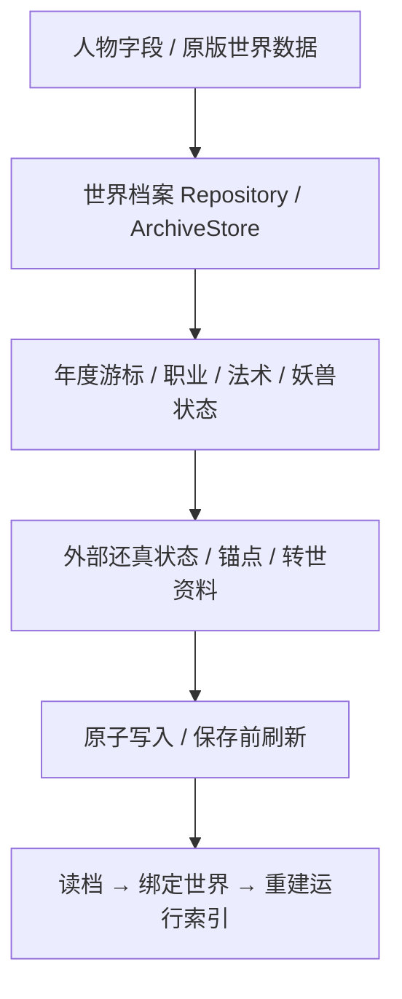


### ⏱️ 判断条件与刷新频率

|功能|主要判断条件|检查/执行频率|时钟口径|暂停与延迟行为|源码|
|---|---|---|---|---|---|
|存档、转世外部资料、轮回快照|原版保存/读档、回溯请求或业务显式Flush；写锁和初始化状态约束|事件驱动；保存前排空年度游标/背包等待写；不是按固定秒自动写全部档案|保存/读档/业务事件|允许暂停保存；具体恢复必须走现有流程|[MclslRuntime.cs:254](../../code/MySimulatedLongevityRoad/Core/MclslRuntime.cs)|

## 🖥️ 20 · 界面、命令与查询

UiManager 注册生灵目录、指南、人物扩展、背包、市场、榜单、法术图鉴、玄黄仙录、还真与冒泡窗口。UnitWindowLifecycle 管原版人物窗口接入，OverviewStatsFormatter / ActorInfoFormatter 负责属性及文本，ContractInfoBar 负责契约关系。

CodexWindow 拆成史册、人物、宗门、家族、国家、遗迹、道争等 partial 页面；CodexSnapshot 与 BudgetedView 分步形成展示快照。RankSnapshotSource / RankCard / RankWindow 负责榜单，VirtualCardList 减少不可见条目的UI开销。

界面按钮应调用业务命令，业务改变状态后查询/快照更新；界面自己的文本不是存档状态。生灵栏当前是首页分类入口→分类页→返回，妖兽分类图标为裂解鲸，返回使用专用箭头。

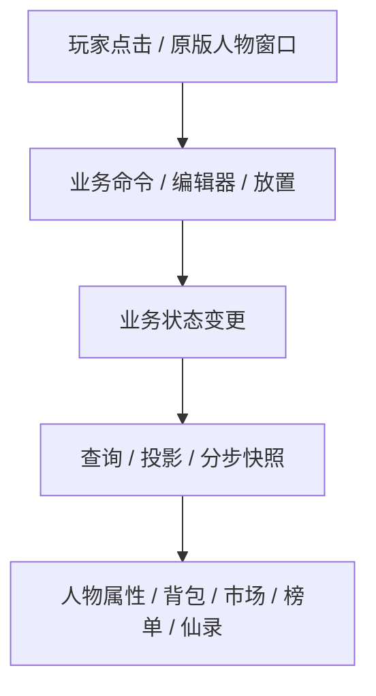


### ⏱️ 判断条件与刷新频率

|功能|主要判断条件|检查/执行频率|时钟口径|暂停与延迟行为|源码|
|---|---|---|---|---|---|
|人物属性与契约关系行|展示入口与相关人物变更通知；比较目标、名字、境界、关系类型，仅变化才写UI|展示/关系事件立即刷新；可见时3现实秒兜底；回调仅在失效后重绑|UI事件 + unscaledTime（优化后见频率栏）|暂停可更新；点击回调在行激活后恢复；无效/死亡目标不跳转|[MclslContractInfoBar.cs:120](../../code/MySimulatedLongevityRoad/UI/MclslContractInfoBar.cs)|
|榜单数据更新|存在待更新队列；可见性使用现有窗口状态；打开窗口立即取消隐藏时的等待|可见时1现实秒节流，隐藏时5现实秒；未处理完队列可后续帧续做|变更事件 + unscaledTime（优化后见频率栏）|UI数据更新可继续；不会改变人物游戏进度|[MclslRankSnapshotSource.cs:74](../../code/MySimulatedLongevityRoad/UI/MclslRankSnapshotSource.cs)|
|玄黄仙录与史册|窗口打开/手动重新照录等操作触发BeginSnapshot；Update仅推进构建、人物索引及窗口控制|一次性快照分帧构建，完成后不自动周期重建概览|打开/操作事件 + 构建帧|可在暂停中构建；显示不自动实时追随全部档案变化|[MclslCodexWindow.cs:110](../../code/MySimulatedLongevityRoad/UI/MclslCodexWindow.cs)|
|生灵目录、返回与手动放置|点击分类/返回/放置按钮；OnEnable回到首页|用户交互事件，无后台定时刷新分类|UI事件|暂停可操作目录；放置由具体原版入口决定|[MclslLivingCatalog.cs:68](../../code/MySimulatedLongevityRoad/UI/MclslLivingCatalog.cs)|

## 🔗 21 · 模块之间的主要勾连

最重要的循环：世界资源→人物突破→职业战斗→死亡→世界资源释放。经济循环：任务/材料/掉落→个人及家族库存→生产/交易→修炼与战斗消耗。传承循环：功法/师承→家族与宗门→人物成长→新道统和历史。

所有这些循环通过同一套人物身份、世界仓库与年度调度勾连；UI读取它们的查询投影。下方关系是行为归纳；完整逐文件静态类型引用可在 source-inventory.json 中追溯。静态引用不覆盖 Harmony、委托和反射隐式调用。

```mermaid
flowchart TD
  g20n0_0["世界资源 / 纪元"]
  g20n1_0["修炼 / 功法"]
  g20n1_1["经济 / 家族"]
  g20n2_0["职业 / 法术 / 妖兽战斗"]
  g20n3_0["死亡 / 传承 / 还真"]
  g20n4_0["人物数据 + 世界档案"]
  g20n5_0["查询 / UI / 视觉"]
  g20n0_0 --> g20n1_0
  g20n0_0 --> g20n1_1
  g20n1_0 --> g20n2_0
  g20n1_1 --> g20n2_0
  g20n2_0 --> g20n3_0
  g20n3_0 --> g20n4_0
  g20n4_0 --> g20n5_0
```


### ⏱️ 判断条件与刷新频率

|功能|主要判断条件|检查/执行频率|时钟口径|暂停与延迟行为|源码|
|---|---|---|---|---|---|
|公告队列|队列非空、达到显示间隔、EarliestFrame到期，并做文本去重/重复冷却|每帧尝试，最短2.4 unscaled现实秒显示一条；并非入队即全部显示|unscaled现实秒 / 帧|没有统一世界暂停门槛；暂停可继续显示排队消息|[MclslAnnouncementSystem.cs:11](../../code/MySimulatedLongevityRoad/Systems/Runtime/MclslAnnouncementSystem.cs)|

## 📁 22 · 全量源码目录与导航

以下为磁盘上的实际文件，不代表每个类型均有调用。文件路径、行数、类型名及 SHA256 见 source-inventory.json；类型静态引用是语法级扫描，不是编译器语义图。

|模块|C#文件数|
|---|---:|
|Adventure|5|
|Aliases|1|
|Beasts|19|
|Combat|9|
|Core|30|
|Crafting|15|
|Cultivation|38|
|Data|31|
|Death|4|
|Entry|1|
|Family|7|
|Grant|2|
|Interop|1|
|Patches|9|
|Progression|3|
|Queries|2|
|Reincarnation|7|
|Runtime|19|
|Traits|10|
|UI|58|
|Visual|10|
|WorldResources|15|
|WorldSoul|4|

### Adventure

- [MclslAdventureSystem.cs](../../code/MySimulatedLongevityRoad/Systems/Adventure/MclslAdventureSystem.cs)：875行；MclslAdventureSystem
- [MclslFactionExchangeSystem.cs](../../code/MySimulatedLongevityRoad/Systems/Adventure/MclslFactionExchangeSystem.cs)：303行；MclslFactionExchangeSystem
- [MclslFactionMissionSystem.cs](../../code/MySimulatedLongevityRoad/Systems/Adventure/MclslFactionMissionSystem.cs)：413行；MclslFactionMissionSystem
- [MclslFactionPressureSystem.cs](../../code/MySimulatedLongevityRoad/Systems/Adventure/MclslFactionPressureSystem.cs)：307行；MclslFactionPressureSystem
- [MclslRuinText.cs](../../code/MySimulatedLongevityRoad/Systems/Adventure/MclslRuinText.cs)：37行；MclslRuinText

### Aliases

- [GlobalAliases.cs](../../code/GlobalAliases.cs)：2行；

### Beasts

- [MclslActorAnimationCatalog.cs](../../code/MySimulatedLongevityRoad/Systems/Beasts/MclslActorAnimationCatalog.cs)：218行；MclslActorAnimationCatalog
- [MclslActorAnimationState.cs](../../code/MySimulatedLongevityRoad/Systems/Beasts/MclslActorAnimationState.cs)：48行；MclslActorAction, MclslActorAnimationState
- [MclslActorAnimationTime.cs](../../code/MySimulatedLongevityRoad/Systems/Beasts/MclslActorAnimationTime.cs)：24行；MclslActorAnimationTime
- [MclslActorFrameCache.cs](../../code/MySimulatedLongevityRoad/Systems/Beasts/MclslActorFrameCache.cs)：182行；MclslActorFrameCache
- [MclslActorPixelResources.cs](../../code/MySimulatedLongevityRoad/Systems/Beasts/MclslActorPixelResources.cs)：229行；MclslActorPixelResources
- [MclslActorPresentation.cs](../../code/MySimulatedLongevityRoad/Systems/Beasts/MclslActorPresentation.cs)：223行；MclslActorPresentation
- [MclslAnimationClipData.cs](../../code/MySimulatedLongevityRoad/Systems/Beasts/MclslAnimationClipData.cs)：50行；MclslAnimationClipData
- [MclslBeastAnimation.cs](../../code/MySimulatedLongevityRoad/Systems/Beasts/MclslBeastAnimation.cs)：284行；MclslBeastAnimation
- [MclslBeastConfig.cs](../../code/MySimulatedLongevityRoad/Systems/Beasts/MclslBeastConfig.cs)：124行；MclslBeastConfig
- [MclslBeastCultivation.cs](../../code/MySimulatedLongevityRoad/Systems/Beasts/MclslBeastCultivation.cs)：104行；MclslBeastCultivation
- [MclslBeastLoot.cs](../../code/MySimulatedLongevityRoad/Systems/Beasts/MclslBeastLoot.cs)：145行；MclslBeastLootDelivery, MclslBeastLootState, MclslBeastLoot
- [MclslBeastPopulationIndex.cs](../../code/MySimulatedLongevityRoad/Systems/Beasts/MclslBeastPopulationIndex.cs)：88行；MclslBeastPopulationIndex
- [MclslBeastSpawnSystem.cs](../../code/MySimulatedLongevityRoad/Systems/Beasts/MclslBeastSpawnSystem.cs)：17行；MclslBeastSpawnSystem
- [MclslBeastSurfaceIndex.cs](../../code/MySimulatedLongevityRoad/Systems/Beasts/MclslBeastSurfaceIndex.cs)：178行；MclslBeastSurfaceIndex
- [MclslBeastTalentSystem.cs](../../code/MySimulatedLongevityRoad/Systems/Beasts/MclslBeastTalentSystem.cs)：587行；MclslTalentEffectState, MclslTalentActorState, MclslTalentWorldState, MclslBeastTalentSystem
- [MclslBeastWorld.cs](../../code/MySimulatedLongevityRoad/Systems/Beasts/MclslBeastWorld.cs)：332行；MclslBeastWaveState, MclslBeastWorldState, MclslBeastWorld
- [MclslNativeActorFrames.cs](../../code/MySimulatedLongevityRoad/Systems/Beasts/MclslNativeActorFrames.cs)：141行；MclslNativeActorFrames
- [MclslSoulFrameCatalog.cs](../../code/MySimulatedLongevityRoad/Systems/Beasts/MclslSoulFrameCatalog.cs)：123行；MclslSoulFrameCatalog
- [MclslSpriteOwnership.cs](../../code/MySimulatedLongevityRoad/Systems/Beasts/MclslSpriteOwnership.cs)：28行；MclslSpriteOwnership

### Combat

- [MclslCareerBattleState.cs](../../code/MySimulatedLongevityRoad/Systems/Combat/MclslCareerBattleState.cs)：46行；MclslCareerCast, MclslCareerZone, MclslCareerSummon, MclslCareerMark, MclslCareerBattleState
- [MclslCareerCombat.cs](../../code/MySimulatedLongevityRoad/Systems/Combat/MclslCareerCombat.cs)：599行；MclslCareerCombat
- [MclslCareerContract.cs](../../code/MySimulatedLongevityRoad/Systems/Combat/MclslCareerContract.cs)：417行；MclslContractInfo, MclslCareerCombat
- [MclslCareerStateValidation.cs](../../code/MySimulatedLongevityRoad/Systems/Combat/MclslCareerStateValidation.cs)：92行；MclslCareerStateValidation
- [MclslCareerSupply.cs](../../code/MySimulatedLongevityRoad/Systems/Combat/MclslCareerSupply.cs)：93行；MclslCareerSupply
- [MclslCombatCareerPersistence.cs](../../code/MySimulatedLongevityRoad/Systems/Combat/MclslCombatCareerPersistence.cs)：64行；MclslCombatCareerSystem
- [MclslCombatCareerSystem.cs](../../code/MySimulatedLongevityRoad/Systems/Combat/MclslCombatCareerSystem.cs)：277行；MclslCombatCareerSystem
- [MclslContractRules.cs](../../code/MySimulatedLongevityRoad/Systems/Combat/MclslContractRules.cs)：134行；MclslContractRules
- [MclslRealmSuppressionSystem.cs](../../code/MySimulatedLongevityRoad/Systems/Combat/MclslRealmSuppressionSystem.cs)：72行；MclslRealmSuppressionSystem

### Core

- [MclslAnnualResiliencePolicy.cs](../../code/MySimulatedLongevityRoad/Core/MclslAnnualResiliencePolicy.cs)：38行；MclslRecoverySource, MclslPrimaryBackupRecovery, MclslAnnualTargetCursor
- [MclslAnnualSchedulingPolicy.cs](../../code/MySimulatedLongevityRoad/Core/MclslAnnualSchedulingPolicy.cs)：278行；MclslAnnualReadyQueue, MclslAnnualSpeedPolicy, MclslAnnualFrameBudget, MclslAnnualAdvance, MclslAnnualWorkMetrics, MclslInitialCultivationPolicy, MclslFirstCultivationQueue
- [MclslAnnualYearReconcilePolicy.cs](../../code/MySimulatedLongevityRoad/Core/MclslAnnualYearReconcilePolicy.cs)：84行；MclslAnnualYearReconcilePolicy
- [MclslAtomicFile.cs](../../code/MySimulatedLongevityRoad/Core/MclslAtomicFile.cs)：69行；MclslArchiveReadResult, MclslAtomicFile
- [MclslBudgetedView.cs](../../code/MySimulatedLongevityRoad/Core/MclslBudgetedView.cs)：90行；MclslBudgetedView
- [MclslConfig.cs](../../code/MySimulatedLongevityRoad/Core/MclslConfig.cs)：80行；MclslConfig
- [MclslConfigLocalization.cs](../../code/MySimulatedLongevityRoad/Core/MclslConfigLocalization.cs)：62行；MclslConfigLocalization
- [MclslDeveloperBridge.cs](../../code/MySimulatedLongevityRoad/Core/MclslDeveloperBridge.cs)：89行；MclslDeveloperBridge
- [MclslDiagnostics.cs](../../code/MySimulatedLongevityRoad/Core/MclslDiagnostics.cs)：141行；MclslDiagnostics
- [MclslFrameLoadMonitor.cs](../../code/MySimulatedLongevityRoad/Core/MclslFrameLoadMonitor.cs)：58行；MclslRuntimeStressTier, MclslFrameLoadMonitor
- [MclslMemoryMaintenance.cs](../../code/MySimulatedLongevityRoad/Core/MclslMemoryMaintenance.cs)：28行；MclslMemoryMaintenance
- [MclslModuleLoadState.cs](../../code/MySimulatedLongevityRoad/Core/MclslModuleLoadState.cs)：15行；MclslModuleLoadStatus, MclslModuleLoadState
- [MclslOrderedIdIndex.cs](../../code/MySimulatedLongevityRoad/Core/MclslOrderedIdIndex.cs)：144行；MclslOrderedIdIndex, MclslOrderedChangeRange
- [MclslOwnerRound.cs](../../code/MySimulatedLongevityRoad/Core/MclslOwnerRound.cs)：35行；MclslOwnerRound
- [MclslPerformanceProbe.cs](../../code/MySimulatedLongevityRoad/Core/MclslPerformanceProbe.cs)：871行；MclslPerformanceProbe
- [MclslReflectionNumbers.cs](../../code/MySimulatedLongevityRoad/Core/MclslReflectionNumbers.cs)：104行；MclslReflectionNumbers
- [MclslRuntime.cs](../../code/MySimulatedLongevityRoad/Core/MclslRuntime.cs)：322行；MclslRuntime
- [MclslRuntimeChanges.cs](../../code/MySimulatedLongevityRoad/Core/MclslRuntimeChanges.cs)：267行；MclslActorChange, MclslRuntimeChanges
- [MclslRuntimeCollections.cs](../../code/MySimulatedLongevityRoad/Core/MclslRuntimeCollections.cs)：194行；MclslIdSlots, MclslChangeQueue, MclslActorThreadHandoff, MclslFrameDeadline
- [MclslRuntimeDriver.cs](../../code/MySimulatedLongevityRoad/Core/MclslRuntimeDriver.cs)：43行；MclslRuntimeDriver
- [MclslRuntimeSettings.cs](../../code/MySimulatedLongevityRoad/Core/MclslRuntimeSettings.cs)：245行；MclslRuntimeSettings
- [MclslSpriteLoader.cs](../../code/MySimulatedLongevityRoad/Core/MclslSpriteLoader.cs)：25行；MclslSpriteLoader
- [MclslStableHash.cs](../../code/MySimulatedLongevityRoad/Core/MclslStableHash.cs)：33行；MclslStableHash
- [MclslStartupTiming.cs](../../code/MySimulatedLongevityRoad/Core/MclslStartupTiming.cs)：34行；MclslStartupTiming
- [MclslTextValue.cs](../../code/MySimulatedLongevityRoad/Core/MclslTextValue.cs)：59行；MclslTextValue
- [MclslTimedPulseQueue.cs](../../code/MySimulatedLongevityRoad/Core/MclslTimedPulseQueue.cs)：70行；MclslTimedPulseQueue
- [MclslUnityProfiler.cs](../../code/MySimulatedLongevityRoad/Core/MclslUnityProfiler.cs)：31行；MclslUnityProfiler
- [MclslWorldContext.cs](../../code/MySimulatedLongevityRoad/Core/MclslWorldContext.cs)：37行；MclslWorldContext
- [MclslWorldInitialization.cs](../../code/MySimulatedLongevityRoad/Core/MclslWorldInitialization.cs)：21行；MclslWorldInitializationStatus, MclslWorldInitialization
- [MclslWorldStateAudit.cs](../../code/MySimulatedLongevityRoad/Core/MclslWorldStateAudit.cs)：73行；MclslWorldStateAudit

### Crafting

- [MclslAnnualEconomyPlan.cs](../../code/MySimulatedLongevityRoad/Systems/Crafting/MclslAnnualEconomyPlan.cs)：79行；MclslAnnualEconomyPlan
- [MclslArtifactEquipmentSystem.cs](../../code/MySimulatedLongevityRoad/Systems/Crafting/MclslArtifactEquipmentSystem.cs)：467行；MclslArtifactSystem
- [MclslArtifactRain.cs](../../code/MySimulatedLongevityRoad/Systems/Crafting/MclslArtifactRain.cs)：139行；MclslArtifactRain
- [MclslBeastItemEffects.cs](../../code/MySimulatedLongevityRoad/Systems/Crafting/MclslBeastItemEffects.cs)：223行；MclslBeastItemEffects
- [MclslConsumableInventoryPolicy.cs](../../code/MySimulatedLongevityRoad/Systems/Crafting/MclslConsumableInventoryPolicy.cs)：270行；MclslConsumableUseTrigger, MclslConsumableInventoryPolicy
- [MclslEconomicPolicy.cs](../../code/MySimulatedLongevityRoad/Systems/Crafting/MclslEconomicPolicy.cs)：141行；MclslEconomicPolicy
- [MclslItemAcquisitionHistoryPolicy.cs](../../code/MySimulatedLongevityRoad/Systems/Crafting/MclslItemAcquisitionHistoryPolicy.cs)：18行；MclslItemAcquisitionHistoryPolicy
- [MclslItemEconomy.cs](../../code/MySimulatedLongevityRoad/Systems/Crafting/MclslItemEconomy.cs)：798行；MclslBagSystem, MclslProfessionSystem
- [MclslItemUseSystem.cs](../../code/MySimulatedLongevityRoad/Systems/Crafting/MclslItemUseSystem.cs)：503行；MclslItemEffectDriver, MclslItemUseSystem
- [MclslJulingMarrowMetrics.cs](../../code/MySimulatedLongevityRoad/Systems/Crafting/MclslJulingMarrowMetrics.cs)：17行；MclslJulingMarrowMetrics
- [MclslMaterialDiscovery.cs](../../code/MySimulatedLongevityRoad/Systems/Crafting/MclslMaterialDiscovery.cs)：337行；MclslMaterialDiscovery
- [MclslMentorshipGiftSystem.cs](../../code/MySimulatedLongevityRoad/Systems/Crafting/MclslMentorshipGiftSystem.cs)：230行；MclslMentorshipGiftSystem, MclslRecipeKnowledge
- [MclslProfessionCraftingPolicy.cs](../../code/MySimulatedLongevityRoad/Systems/Crafting/MclslProfessionCraftingPolicy.cs)：46行；MclslProfessionCraftingPolicy
- [MclslSpellScrollCrafting.cs](../../code/MySimulatedLongevityRoad/Systems/Crafting/MclslSpellScrollCrafting.cs)：81行；MclslSpellScrollCrafting
- [MclslTianxuanMarket.cs](../../code/MySimulatedLongevityRoad/Systems/Crafting/MclslTianxuanMarket.cs)：1608行；MclslMarketPurchaseStep, MclslTianxuanMarket

### Cultivation

- [MclslAncientLawBreakthroughSystem.cs](../../code/MySimulatedLongevityRoad/Systems/Cultivation/MclslAncientLawBreakthroughSystem.cs)：286行；MclslAncientLawBreakthroughSystem
- [MclslAncientLawEntrySystem.cs](../../code/MySimulatedLongevityRoad/Systems/Cultivation/MclslAncientLawEntrySystem.cs)：88行；MclslAncientLawEntrySystem
- [MclslAncientLawEventSystem.cs](../../code/MySimulatedLongevityRoad/Systems/Cultivation/MclslAncientLawEventSystem.cs)：392行；MclslAncientLawEventSystem
- [MclslAncientLawSystem.cs](../../code/MySimulatedLongevityRoad/Systems/Cultivation/MclslAncientLawSystem.cs)：189行；MclslAncientLawSystem
- [MclslAncientMentorshipSystem.cs](../../code/MySimulatedLongevityRoad/Systems/Cultivation/MclslAncientMentorshipSystem.cs)：455行；MclslAncientMentorshipSystem
- [MclslAnnualCultivationExecutor.cs](../../code/MySimulatedLongevityRoad/Systems/Cultivation/MclslAnnualCultivationExecutor.cs)：248行；MclslAnnualCultivationExecutor
- [MclslChildhoodRootSystem.cs](../../code/MySimulatedLongevityRoad/Systems/Cultivation/MclslChildhoodRootSystem.cs)：106行；MclslChildhoodRootSystem
- [MclslCultivationAgeSanity.cs](../../code/MySimulatedLongevityRoad/Systems/Cultivation/MclslCultivationAgeSanity.cs)：160行；MclslCultivationAgeSanity
- [MclslCultivationGrowthSystem.cs](../../code/MySimulatedLongevityRoad/Systems/Cultivation/MclslCultivationGrowthSystem.cs)：201行；MclslCultivationGrowthSystem
- [MclslCultivationLineage.cs](../../code/MySimulatedLongevityRoad/Systems/Cultivation/MclslCultivationLineage.cs)：67行；MclslCultivationLineage
- [MclslCultivationLocalCore.cs](../../code/MySimulatedLongevityRoad/Systems/Cultivation/MclslCultivationLocalCore.cs)：111行；MclslCultivationAnnualSnapshot, MclslCultivationLocalCheckResult, MclslCultivationLocalCore
- [MclslCultivationStateTransitions.cs](../../code/MySimulatedLongevityRoad/Systems/Cultivation/MclslCultivationStateTransitions.cs)：238行；MclslCultivationStateTransitions
- [MclslCultivationSystem.cs](../../code/MySimulatedLongevityRoad/Systems/Cultivation/MclslCultivationSystem.cs)：923行；MclslCultivationSystem
- [MclslCultivationSystemIds.cs](../../code/MySimulatedLongevityRoad/Systems/Cultivation/MclslCultivationSystemIds.cs)：7行；MclslCultivationSystemIds
- [MclslCultivationWake.cs](../../code/MySimulatedLongevityRoad/Systems/Cultivation/MclslCultivationWake.cs)：188行；MclslCultivationWake
- [MclslImmortalPathSystem.cs](../../code/MySimulatedLongevityRoad/Systems/Cultivation/MclslImmortalPathSystem.cs)：147行；MclslImmortalPathSystem
- [MclslMindSystem.cs](../../code/MySimulatedLongevityRoad/Systems/Cultivation/MclslMindSystem.cs)：166行；MclslMindSystem
- [MclslMortalFateEventSystem.cs](../../code/MySimulatedLongevityRoad/Systems/Cultivation/MclslMortalFateEventSystem.cs)：116行；MclslMortalFateEventSystem
- [MclslNewLawBreakthroughSystem.cs](../../code/MySimulatedLongevityRoad/Systems/Cultivation/MclslNewLawBreakthroughSystem.cs)：208行；MclslNewLawBreakthroughSystem
- [MclslNewLawEntrySystem.cs](../../code/MySimulatedLongevityRoad/Systems/Cultivation/MclslNewLawEntrySystem.cs)：120行；MclslNewLawEntrySystem
- [MclslNewLawEventSystem.cs](../../code/MySimulatedLongevityRoad/Systems/Cultivation/MclslNewLawEventSystem.cs)：237行；MclslNewLawEventSystem
- [MclslNewLawPioneerSystem.cs](../../code/MySimulatedLongevityRoad/Systems/Cultivation/MclslNewLawPioneerSystem.cs)：170行；MclslNewLawPioneerSystem
- [MclslRealmSeatSystem.cs](../../code/MySimulatedLongevityRoad/Systems/Cultivation/MclslRealmSeatSystem.cs)：82行；MclslRealmSeatSystem
- [MclslSectLifecycleSystem.cs](../../code/MySimulatedLongevityRoad/Systems/Cultivation/MclslSectLifecycleSystem.cs)：144行；MclslSectLifecycleSystem
- [MclslSensingQiSystem.cs](../../code/MySimulatedLongevityRoad/Systems/Cultivation/MclslSensingQiSystem.cs)：89行；MclslSensingQiSystem
- [MclslSpellAcquisitionPolicy.cs](../../code/MySimulatedLongevityRoad/Systems/Cultivation/MclslSpellAcquisitionPolicy.cs)：48行；MclslSpellAcquisitionPolicy
- [MclslSpellCasting.cs](../../code/MySimulatedLongevityRoad/Systems/Cultivation/MclslSpellCasting.cs)：288行；MclslPendingSpell, MclslCombatTargets, MclslSpellCasting
- [MclslSpellProgression.cs](../../code/MySimulatedLongevityRoad/Systems/Cultivation/MclslSpellProgression.cs)：300行；MclslSpellProgression
- [MclslSpellSupportStage.cs](../../code/MySimulatedLongevityRoad/Systems/Cultivation/MclslSpellSupportStage.cs)：33行；MclslSpellSupportStage
- [MclslSpellSystem.cs](../../code/MySimulatedLongevityRoad/Systems/Cultivation/MclslSpellSystem.cs)：1082行；MclslSpellDefinition, MclslSpellSystem, MclslSpellTerrain, MclslSpellEffect, MclslSpellEffectFrames
- [MclslSpiritualRootEntrySystem.cs](../../code/MySimulatedLongevityRoad/Systems/Cultivation/MclslSpiritualRootEntrySystem.cs)：74行；MclslSpiritualRootEntrySystem
- [MclslSpiritualRootSystem.cs](../../code/MySimulatedLongevityRoad/Systems/Cultivation/MclslSpiritualRootSystem.cs)：326行；MclslSpiritualRootProfile, MclslSpiritualRootSystem
- [MclslTechniqueLineageSystem.cs](../../code/MySimulatedLongevityRoad/Systems/Cultivation/MclslTechniqueLineageSystem.cs)：865行；MclslTechniqueLineageSystem
- [MclslTechniqueMutationSnapshot.cs](../../code/MySimulatedLongevityRoad/Systems/Cultivation/MclslTechniqueMutationSnapshot.cs)：48行；MclslTechniqueMutationSnapshot
- [MclslTechniqueOccupationSystem.cs](../../code/MySimulatedLongevityRoad/Systems/Cultivation/MclslTechniqueOccupationSystem.cs)：477行；MclslTechniqueOccupationSystem
- [MclslTechniqueRealmLimit.cs](../../code/MySimulatedLongevityRoad/Systems/Cultivation/MclslTechniqueRealmLimit.cs)：166行；MclslTechniqueRealmLimit
- [MclslTechniqueStageSystem.cs](../../code/MySimulatedLongevityRoad/Systems/Cultivation/MclslTechniqueStageSystem.cs)：83行；MclslTechniqueStageSystem

### Data

- [MclslDeathSnapshot.cs](../../code/MySimulatedLongevityRoad/Data/Death/MclslDeathSnapshot.cs)：66行；MclslDeathSnapshot
- [MclslActorDataKeys.cs](../../code/MySimulatedLongevityRoad/Data/MclslActorDataKeys.cs)：198行；MclslActorDataKeys
- [MclslAptitudeGiftCatalog.cs](../../code/MySimulatedLongevityRoad/Data/MclslAptitudeGiftCatalog.cs)：121行；MclslAptitudeGiftDefinition, MclslAptitudeGiftCatalog
- [MclslArchiveData.cs](../../code/MySimulatedLongevityRoad/Data/MclslArchiveData.cs)：550行；MclslWorldArchiveBundle, MclslWorldRunState, MclslAnnualBatchState, MclslInverseAnnualState, MclslInverseTruthContext, MclslAnnualFailureRecord, MclslAnnualClaimRecord, MclslBackgroundFactionState, MclslKnowledgeDiscoveryRecord, MclslTimelineAnchorState, MclslRunEventRecord, MclslDeathRecord, MclslActorReincarnationRecord, MclslFactionMissionRecord, MclslFactionPressureRecord, MclslResourceSpendRecord, MclslTechniqueLineageRecord, MclslSectRuinRecord, MclslRuinExplorationRecord, MclslGeneratedItemRecord, MclslWorldCaveRecord, MclslWorldChangeRecord, MclslWorldSoulRecord, MclslInverseTruthRecord, MclslReincarnationProfile
- [MclslBeastCatalog.cs](../../code/MySimulatedLongevityRoad/Data/MclslBeastCatalog.cs)：93行；MclslBeastSurface, MclslBeastDefinition, MclslBeastCatalog
- [MclslBeastConsumables.cs](../../code/MySimulatedLongevityRoad/Data/MclslBeastConsumables.cs)：43行；MclslBeastConsumableDefinition, MclslBeastConsumables
- [MclslBeastContent.cs](../../code/MySimulatedLongevityRoad/Data/MclslBeastContent.cs)：205行；MclslBeastContentRow, MclslRecipeIngredient, MclslRecipeDefinition, MclslBeastContent, MclslRecipeCatalog
- [MclslBeastRules.cs](../../code/MySimulatedLongevityRoad/Data/MclslBeastRules.cs)：30行；MclslBeastRules
- [MclslBeastTalentCatalog.cs](../../code/MySimulatedLongevityRoad/Data/MclslBeastTalentCatalog.cs)：55行；MclslBeastTalentDefinition, MclslBeastTalentCatalog
- [MclslCleanupPolicy.cs](../../code/MySimulatedLongevityRoad/Data/MclslCleanupPolicy.cs)：33行；MclslCleanupPolicy
- [MclslCombatCareerCatalog.cs](../../code/MySimulatedLongevityRoad/Data/MclslCombatCareerCatalog.cs)：120行；MclslCombatCareerDefinition, MclslCareerSkill, MclslCombatCareerCatalog, MclslCombatCareerState
- [MclslCultivationCatalog.cs](../../code/MySimulatedLongevityRoad/Data/MclslCultivationCatalog.cs)：252行；MclslRealmIds, MclslTechniqueDefinition, MclslCultivationCatalog, MclslGeneratedKinds
- [MclslCultivatorIncomePolicy.cs](../../code/MySimulatedLongevityRoad/Data/MclslCultivatorIncomePolicy.cs)：66行；MclslCurrencyPair, MclslCultivatorIncomePolicy
- [MclslEconomyState.cs](../../code/MySimulatedLongevityRoad/Data/MclslEconomyState.cs)：202行；MclslCurrency, MclslEconomicKind, MclslEconomicResult, MclslWalletState, MclslCurrencyLedgerTotals, MclslEconomicYearTotals, MclslEconomyState, MclslEconomicOperation, MclslEconomicTransaction
- [MclslEventCatalog.cs](../../code/MySimulatedLongevityRoad/Data/MclslEventCatalog.cs)：193行；MclslEventCategoryDefinition, MclslEventCatalog
- [MclslEventTrimPolicy.cs](../../code/MySimulatedLongevityRoad/Data/MclslEventTrimPolicy.cs)：55行；MclslEventTrimPolicy
- [MclslFactionMissionCatalog.cs](../../code/MySimulatedLongevityRoad/Data/MclslFactionMissionCatalog.cs)：97行；MclslMissionSettlementPolicy, MclslMissionDefinition, MclslFactionMissionCatalog
- [MclslFamilyData.cs](../../code/MySimulatedLongevityRoad/Data/MclslFamilyData.cs)：90行；MclslFamilyRuleMode, MclslFamilyRecord, MclslFamilyTechniqueRecord, MclslFamilyMemberRecord, MclslFamilyTransferPolicy
- [MclslHonorificNameCatalog.cs](../../code/MySimulatedLongevityRoad/Data/MclslHonorificNameCatalog.cs)：948行；MclslHonorificNameCatalog
- [MclslHuanzhenData.cs](../../code/MySimulatedLongevityRoad/Data/MclslHuanzhenData.cs)：244行；MclslHuanzhenExternalState, MclslHuanzhenEssenceLedger, MclslHuanzhenLegacyRecord, MclslHuanzhenEssenceRecord, MclslHuanzhenAnchorRecord, MclslHuanzhenPendingRestore, MclslHuanzhenLegacyOption, MclslHuanzhenHistoryRecord, MclslHuanzhenCultivationSnapshot, MclslHuanzhenDeathSnapshot, MclslWorldSoulDeathSnapshot, MclslDeathPatchState
- [MclslItemCatalog.cs](../../code/MySimulatedLongevityRoad/Data/MclslItemCatalog.cs)：387行；MclslMaterialSource, MclslMaterialHabitat, MclslMaterialTier, MclslArtifactEquipmentSlot, MclslItemDefinition, MclslItemCatalog
- [MclslItemState.cs](../../code/MySimulatedLongevityRoad/Data/MclslItemState.cs)：185行；MclslOwnedItem, MclslBagState, MclslMentorshipBook, MclslMarketListing, MclslMarketActivity, MclslMarketPriceState, MclslInventoryDataRules
- [MclslKnowledgeCatalog.cs](../../code/MySimulatedLongevityRoad/Data/MclslKnowledgeCatalog.cs)：60行；MclslKnowledgeDefinition, MclslTimelineAnchorDefinition, MclslKnowledgeCatalog
- [MclslLawInteractionCatalog.cs](../../code/MySimulatedLongevityRoad/Data/MclslLawInteractionCatalog.cs)：146行；MclslLawInteractionCatalog
- [MclslMarketPurchaseBatch.cs](../../code/MySimulatedLongevityRoad/Data/MclslMarketPurchaseBatch.cs)：75行；MclslMarketPurchaseSequence, MclslMarketPayment, MclslMarketPaymentPolicy, MclslMarketPurchaseNeed, MclslMarketPurchaseBatch, MclslMarketPurchasePolicy
- [MclslMinorRealmCatalog.cs](../../code/MySimulatedLongevityRoad/Data/MclslMinorRealmCatalog.cs)：61行；MclslMinorRealmStage, MclslMinorRealmCatalog
- [MclslNativeTerrainProfileCatalog.cs](../../code/MySimulatedLongevityRoad/Data/MclslNativeTerrainProfileCatalog.cs)：68行；MclslNativeTerrainProfile, MclslNativeTerrainProfileCatalog
- [MclslProceduralLexicon.cs](../../code/MySimulatedLongevityRoad/Data/MclslProceduralLexicon.cs)：229行；MclslProceduralLexicon
- [MclslRealmProgress.cs](../../code/MySimulatedLongevityRoad/Data/MclslRealmProgress.cs)：78行；MclslRealmProgress
- [MclslRealmRequirementCatalog.cs](../../code/MySimulatedLongevityRoad/Data/MclslRealmRequirementCatalog.cs)：113行；MclslRealmRequirementDefinition, MclslRealmRequirementCatalog
- [MclslSaveVersions.cs](../../code/MySimulatedLongevityRoad/Data/MclslSaveVersions.cs)：9行；MclslSaveVersions

### Death

- [MclslDeathEventRouter.cs](../../code/MySimulatedLongevityRoad/Systems/Death/MclslDeathEventRouter.cs)：47行；MclslDeathEventRouter
- [MclslDeathSystem.cs](../../code/MySimulatedLongevityRoad/Systems/Death/MclslDeathSystem.cs)：730行；MclslDeathSystem
- [MclslMortalMiasmaSystem.cs](../../code/MySimulatedLongevityRoad/Systems/Death/MclslMortalMiasmaSystem.cs)：101行；MclslMortalMiasmaSystem
- [MclslNativeKillStatisticsSystem.cs](../../code/MySimulatedLongevityRoad/Systems/Death/MclslNativeKillStatisticsSystem.cs)：284行；MclslNativeKillStatisticsSystem, MclslNativeKillAttemptState

### Entry

- [MclslMod.cs](../../MclslMod.cs)：94行；MclslMod

### Family

- [MclslFamilySystem.cs](../../code/MySimulatedLongevityRoad/Systems/Family/MclslFamilySystem.cs)：792行；MclslFamilySystem
- [MclslFamilySystem.Inventory.cs](../../code/MySimulatedLongevityRoad/Systems/Family/MclslFamilySystem.Inventory.cs)：495行；MclslFamilyTransferOutcome, MclslFamilyStock, MclslFamilySystem
- [MclslFamilySystem.Paternal.cs](../../code/MySimulatedLongevityRoad/Systems/Family/MclslFamilySystem.Paternal.cs)：171行；MclslFamilySystem
- [MclslFamilySystem.Reconciliation.cs](../../code/MySimulatedLongevityRoad/Systems/Family/MclslFamilySystem.Reconciliation.cs)：99行；MclslFamilySystem
- [MclslFamilySystem.Supply.cs](../../code/MySimulatedLongevityRoad/Systems/Family/MclslFamilySystem.Supply.cs)：199行；MclslFamilyPriorityAid, MclslFamilySystem
- [MclslFamilySystem.Techniques.cs](../../code/MySimulatedLongevityRoad/Systems/Family/MclslFamilySystem.Techniques.cs)：280行；MclslFamilySystem
- [MclslFamilySystem.Views.cs](../../code/MySimulatedLongevityRoad/Systems/Family/MclslFamilySystem.Views.cs)：515行；MclslFamilyMemberFilter, MclslFamilyMemberSummary, MclslFamilySystem

### Grant

- [MclslHeavenGrantActions.cs](../../code/MySimulatedLongevityRoad/Systems/MclslHeavenGrantActions.cs)：172行；MclslHeavenGrantActions
- [MclslTraitGrantRouter.cs](../../code/MySimulatedLongevityRoad/Systems/MclslTraitGrantRouter.cs)：227行；MclslTraitGrantRouter

### Interop

- [MclslLocalizationRuntimeMarker.cs](../../code/MySimulatedLongevityRoad/Interop/MclslLocalizationRuntimeMarker.cs)：30行；MclslLocalizationRuntimeMarker

### Patches

- [MclslBeastRuntimePatches.cs](../../code/MySimulatedLongevityRoad/Patches/MclslBeastRuntimePatches.cs)：36行；MclslBeastRuntimePatches
- [MclslBeastTalentPatches.cs](../../code/MySimulatedLongevityRoad/Patches/MclslBeastTalentPatches.cs)：38行；MclslBeastTalentPatches
- [MclslCareerPatches.cs](../../code/MySimulatedLongevityRoad/Patches/MclslCareerPatches.cs)：43行；MclslCareerPatches
- [MclslCombatPatches.cs](../../code/MySimulatedLongevityRoad/Patches/MclslCombatPatches.cs)：121行；MclslCombatPatches
- [MclslHarmonyPatchGuard.cs](../../code/MySimulatedLongevityRoad/Patches/MclslHarmonyPatchGuard.cs)：48行；MclslHarmonyPatchGuard
- [MclslLifecyclePatches.cs](../../code/MySimulatedLongevityRoad/Patches/MclslLifecyclePatches.cs)：49行；MclslLifecyclePatches
- [MclslNativeFeedbackPatches.cs](../../code/MySimulatedLongevityRoad/Patches/MclslNativeFeedbackPatches.cs)：119行；MclslNativeFeedbackPatches
- [MclslPatches.cs](../../code/MySimulatedLongevityRoad/Patches/MclslPatches.cs)：802行；MclslPatches
- [MclslXuanhuangDirectionPatch.cs](../../code/MySimulatedLongevityRoad/Patches/MclslXuanhuangDirectionPatch.cs)：418行；MclslXuanhuangDirectionPatch

### Progression

- [MclslInverseTruthSystem.cs](../../code/MySimulatedLongevityRoad/Systems/Progression/MclslInverseTruthSystem.cs)：672行；MclslInverseTruthSystem
- [MclslTaishangSystem.cs](../../code/MySimulatedLongevityRoad/Systems/Progression/MclslTaishangSystem.cs)：55行；MclslTaishangSystem
- [MclslTimelineSystem.cs](../../code/MySimulatedLongevityRoad/Systems/Progression/MclslTimelineSystem.cs)：98行；MclslTimelineSystem

### Queries

- [MclslActorCultivationQuery.cs](../../code/MySimulatedLongevityRoad/Queries/MclslActorCultivationQuery.cs)：277行；MclslActorCultivationView, MclslActorCultivationQuery
- [MclslWorldActorQuery.cs](../../code/MySimulatedLongevityRoad/Queries/MclslWorldActorQuery.cs)：51行；MclslWorldActorQuery

### Reincarnation

- [MclslActorReincarnationSystem.cs](../../code/MySimulatedLongevityRoad/Systems/Reincarnation/MclslActorReincarnationSystem.cs)：167行；MclslActorReincarnationSystem
- [MclslHuanzhenSystem.cs](../../code/MySimulatedLongevityRoad/Systems/Reincarnation/MclslHuanzhenSystem.cs)：1624行；MclslHuanzhenSystem
- [MclslMaobaoArchiveManager.cs](../../code/MySimulatedLongevityRoad/Systems/Reincarnation/MclslMaobaoArchiveManager.cs)：350行；MclslMaobaoArchiveManager, MclslNativeActorDataContractResolver
- [MclslMaobaoSnapshot.cs](../../code/MySimulatedLongevityRoad/Systems/Reincarnation/MclslMaobaoSnapshot.cs)：171行；MclslMaobaoSnapshot
- [MclslMaobaoSystem.cs](../../code/MySimulatedLongevityRoad/Systems/Reincarnation/MclslMaobaoSystem.cs)：118行；MclslMaobaoSystem, MclslMaobaoCandidate
- [MclslReincarnationProfileStore.cs](../../code/MySimulatedLongevityRoad/Systems/Reincarnation/MclslReincarnationProfileStore.cs)：41行；MclslReincarnationProfileStore
- [MclslReincarnationService.cs](../../code/MySimulatedLongevityRoad/Systems/Reincarnation/MclslReincarnationService.cs)：24行；MclslReincarnationService

### Runtime

- [MclslActorAccessor.cs](../../code/MySimulatedLongevityRoad/Systems/Runtime/MclslActorAccessor.cs)：181行；MclslActorAccessor
- [MclslActorProjectionIndex.cs](../../code/MySimulatedLongevityRoad/Systems/Runtime/MclslActorProjectionIndex.cs)：321行；MclslActorProjectionIndex
- [MclslActorRegistry.cs](../../code/MySimulatedLongevityRoad/Systems/Runtime/MclslActorRegistry.cs)：399行；MclslActorRegistry
- [MclslActorRelations.cs](../../code/MySimulatedLongevityRoad/Systems/Runtime/MclslActorRelations.cs)：52行；MclslActorRelations
- [MclslActorSelection.cs](../../code/MySimulatedLongevityRoad/Systems/Runtime/MclslActorSelection.cs)：50行；MclslActorSelection
- [MclslAnnouncementSystem.cs](../../code/MySimulatedLongevityRoad/Systems/Runtime/MclslAnnouncementSystem.cs)：147行；MclslAnnouncementSystem
- [MclslAnnualActorPipeline.cs](../../code/MySimulatedLongevityRoad/Systems/Runtime/MclslAnnualActorPipeline.cs)：272行；MclslAnnualPipelineStage, MclslAnnualActorPipeline
- [MclslAnnualBackpressure.cs](../../code/MySimulatedLongevityRoad/Systems/Runtime/MclslAnnualBackpressure.cs)：136行；MclslAnnualBackpressure
- [MclslAnnualExecutionContext.cs](../../code/MySimulatedLongevityRoad/Systems/Runtime/MclslAnnualExecutionContext.cs)：69行；MclslAnnualExecutionContext
- [MclslAnnualWorldRuntimeLane.cs](../../code/MySimulatedLongevityRoad/Systems/Runtime/MclslAnnualWorldRuntimeLane.cs)：270行；MclslAnnualWorldRuntimeLane
- [MclslCultivationActorMarker.cs](../../code/MySimulatedLongevityRoad/Systems/Runtime/MclslCultivationActorMarker.cs)：59行；MclslCultivationActorMarker
- [MclslCultivatorCandidateIndex.cs](../../code/MySimulatedLongevityRoad/Systems/Runtime/MclslCultivatorCandidateIndex.cs)：256行；MclslCultivatorCandidateIndex
- [MclslDetectionGate.cs](../../code/MySimulatedLongevityRoad/Systems/Runtime/MclslDetectionGate.cs)：101行；MclslDetectionGate
- [MclslEligibility.cs](../../code/MySimulatedLongevityRoad/Systems/Runtime/MclslEligibility.cs)：147行；MclslEligibility
- [MclslLocalizationBridge.cs](../../code/MySimulatedLongevityRoad/Systems/Runtime/MclslLocalizationBridge.cs)：114行；MclslLocalizationBridge
- [MclslLongevityRules.cs](../../code/MySimulatedLongevityRoad/Systems/Runtime/MclslLongevityRules.cs)：174行；MclslLongevityRules
- [MclslRuntimeCadence.cs](../../code/MySimulatedLongevityRoad/Systems/Runtime/MclslRuntimeCadence.cs)：55行；MclslRuntimeCadence
- [MclslScheduler.cs](../../code/MySimulatedLongevityRoad/Systems/Runtime/MclslScheduler.cs)：1127行；MclslSchedulerContext, MclslScheduler
- [MclslWorldBootstrapLane.cs](../../code/MySimulatedLongevityRoad/Systems/Runtime/MclslWorldBootstrapLane.cs)：114行；MclslWorldBootstrapLane

### Traits

- [MclslBeastActorRegistration.cs](../../code/MySimulatedLongevityRoad/Traits/MclslBeastActorRegistration.cs)：268行；MclslBeastActorRegistration
- [MclslImmortalActorRegistration.cs](../../code/MySimulatedLongevityRoad/Traits/MclslImmortalActorRegistration.cs)：242行；MclslImmortalActorRegistration
- [MclslNamedCharacterRegistration.cs](../../code/MySimulatedLongevityRoad/Traits/MclslNamedCharacterRegistration.cs)：153行；MclslNamedCharacterRegistration
- [MclslPhysiqueSystem.cs](../../code/MySimulatedLongevityRoad/Traits/MclslPhysiqueSystem.cs)：291行；MclslPhysiqueSystem
- [MclslTraitRegistration.cs](../../code/MySimulatedLongevityRoad/Traits/MclslTraitRegistration.cs)：1251行；MclslTraitRegistration
- [MclslWorldSoulActorRegistration.Attack.cs](../../code/MySimulatedLongevityRoad/Traits/MclslWorldSoulActorRegistration.Attack.cs)：137行；MclslWorldSoulActorRegistration
- [MclslWorldSoulActorRegistration.cs](../../code/MySimulatedLongevityRoad/Traits/MclslWorldSoulActorRegistration.cs)：1032行；MclslWorldSoulActorRegistration
- [MclslWorldSoulActorRegistration.Terrain.cs](../../code/MySimulatedLongevityRoad/Traits/MclslWorldSoulActorRegistration.Terrain.cs)：152行；MclslWorldSoulActorRegistration
- [MclslWorldSoulActorTypes.cs](../../code/MySimulatedLongevityRoad/Traits/MclslWorldSoulActorTypes.cs)：70行；MclslWorldSoulActorDefinitions
- [MclslXuanhuangRegistration.cs](../../code/MySimulatedLongevityRoad/Traits/MclslXuanhuangRegistration.cs)：239行；MclslXuanhuangRegistration

### UI

- [MclslActorArchiveText.cs](../../code/MySimulatedLongevityRoad/UI/MclslActorArchiveText.cs)：20行；MclslActorArchiveText
- [MclslActorInfoFormatter.cs](../../code/MySimulatedLongevityRoad/UI/MclslActorInfoFormatter.cs)：385行；MclslActorInfoFormatter
- [MclslActorInfoPanel.cs](../../code/MySimulatedLongevityRoad/UI/MclslActorInfoPanel.cs)：897行；MclslActorInfoPanel
- [MclslActorOverviewStatsFormatter.cs](../../code/MySimulatedLongevityRoad/UI/MclslActorOverviewStatsFormatter.cs)：478行；MclslActorOverviewStatsFormatter
- [MclslArtifactRainEditor.cs](../../code/MySimulatedLongevityRoad/UI/MclslArtifactRainEditor.cs)：240行；MclslArtifactRainEditor
- [MclslBackpackHeader.cs](../../code/MySimulatedLongevityRoad/UI/MclslBackpackHeader.cs)：482行；MclslBackpackHeader, MclslBackpackHeaderDriver
- [MclslBackpackTabSystem.cs](../../code/MySimulatedLongevityRoad/UI/MclslBackpackTabSystem.cs)：833行；MclslBackpackTabSystem, MclslBackpackTabElement, MclslMentorshipTabElement
- [MclslBeastControlWindow.cs](../../code/MySimulatedLongevityRoad/UI/MclslBeastControlWindow.cs)：238行；MclslBeastControlWindow, MclslBeastControlLifecycle
- [MclslBeastRankWindow.cs](../../code/MySimulatedLongevityRoad/UI/MclslBeastRankWindow.cs)：682行；MclslBeastRankWindow, MclslBeastRankCardView
- [MclslCareerSkillView.cs](../../code/MySimulatedLongevityRoad/UI/MclslCareerSkillView.cs)：200行；MclslCareerSkillView
- [MclslCodexPopulationIndex.cs](../../code/MySimulatedLongevityRoad/UI/MclslCodexPopulationIndex.cs)：119行；MclslCodexPopulationIndex
- [MclslCodexSnapshot.cs](../../code/MySimulatedLongevityRoad/UI/MclslCodexSnapshot.cs)：553行；MclslCodexSnapshot
- [MclslCodexTabs.cs](../../code/MySimulatedLongevityRoad/UI/MclslCodexTabs.cs)：75行；MclslCodexTabCatalog, MclslCodexTab
- [MclslCodexWindow.Atlas.cs](../../code/MySimulatedLongevityRoad/UI/MclslCodexWindow.Atlas.cs)：371行；MclslCodexWindow
- [MclslCodexWindow.Biography.cs](../../code/MySimulatedLongevityRoad/UI/MclslCodexWindow.Biography.cs)：171行；MclslCodexWindow
- [MclslCodexWindow.BiographyArchive.cs](../../code/MySimulatedLongevityRoad/UI/MclslCodexWindow.BiographyArchive.cs)：227行；MclslCodexWindow
- [MclslCodexWindow.cs](../../code/MySimulatedLongevityRoad/UI/MclslCodexWindow.cs)：2408行；MclslCodexWindow
- [MclslCodexWindow.DaoStruggle.cs](../../code/MySimulatedLongevityRoad/UI/MclslCodexWindow.DaoStruggle.cs)：85行；MclslCodexWindow
- [MclslCodexWindow.Families.cs](../../code/MySimulatedLongevityRoad/UI/MclslCodexWindow.Families.cs)：52行；MclslCodexWindow
- [MclslCodexWindow.FamilyArchive.cs](../../code/MySimulatedLongevityRoad/UI/MclslCodexWindow.FamilyArchive.cs)：460行；MclslCodexWindow
- [MclslCodexWindow.HistoryBook.cs](../../code/MySimulatedLongevityRoad/UI/MclslCodexWindow.HistoryBook.cs)：345行；MclslCodexWindow
- [MclslCodexWindow.HuanzhenChronicle.cs](../../code/MySimulatedLongevityRoad/UI/MclslCodexWindow.HuanzhenChronicle.cs)：70行；MclslCodexWindow
- [MclslCodexWindow.Kingdoms.cs](../../code/MySimulatedLongevityRoad/UI/MclslCodexWindow.Kingdoms.cs)：171行；MclslCodexWindow
- [MclslCodexWindow.Maobao.cs](../../code/MySimulatedLongevityRoad/UI/MclslCodexWindow.Maobao.cs)：189行；MclslCodexWindow
- [MclslCodexWindow.Ruins.cs](../../code/MySimulatedLongevityRoad/UI/MclslCodexWindow.Ruins.cs)：252行；MclslCodexWindow
- [MclslCodexWindow.Sects.cs](../../code/MySimulatedLongevityRoad/UI/MclslCodexWindow.Sects.cs)：44行；MclslCodexWindow
- [MclslContractInfoBar.cs](../../code/MySimulatedLongevityRoad/UI/MclslContractInfoBar.cs)：414行；MclslContractInfoBar
- [MclslDeferredUiWork.cs](../../code/MySimulatedLongevityRoad/UI/MclslDeferredUiWork.cs)：24行；MclslDeferredUiWork
- [MclslDeveloperActorEditor.cs](../../code/MySimulatedLongevityRoad/UI/MclslDeveloperActorEditor.cs)：201行；MclslDeveloperActorEditor
- [MclslEventLocator.cs](../../code/MySimulatedLongevityRoad/UI/MclslEventLocator.cs)：100行；MclslEventLocator
- [MclslFeatureWindow.cs](../../code/MySimulatedLongevityRoad/UI/MclslFeatureWindow.cs)：1691行；MclslFeatureWindow
- [MclslFeatureWindow.Guide.cs](../../code/MySimulatedLongevityRoad/UI/MclslFeatureWindow.Guide.cs)：139行；MclslFeatureWindow
- [MclslFpsOverlay.cs](../../code/MySimulatedLongevityRoad/UI/MclslFpsOverlay.cs)：200行；MclslFpsOverlay
- [MclslGenderToggleButton.cs](../../code/MySimulatedLongevityRoad/UI/MclslGenderToggleButton.cs)：118行；MclslGenderToggleButton
- [MclslGuideCatalog.cs](../../code/MySimulatedLongevityRoad/UI/MclslGuideCatalog.cs)：78行；MclslGuideChapter, MclslGuideCatalog
- [MclslLivingCatalog.cs](../../code/MySimulatedLongevityRoad/UI/MclslLivingCatalog.cs)：94行；MclslLivingCatalog, MclslLivingCatalogLifecycle
- [MclslManaBar.cs](../../code/MySimulatedLongevityRoad/UI/MclslManaBar.cs)：109行；MclslManaBar, MclslManaBarBinding
- [MclslMaobaoCommands.cs](../../code/MySimulatedLongevityRoad/UI/MclslMaobaoCommands.cs)：98行；MclslMaobaoCommandResult, MclslMaobaoCommands
- [MclslMaobaoPlaceMode.cs](../../code/MySimulatedLongevityRoad/UI/MclslMaobaoPlaceMode.cs)：77行；MclslMaobaoPlaceMode
- [MclslMaobaoShortcutButton.cs](../../code/MySimulatedLongevityRoad/UI/MclslMaobaoShortcutButton.cs)：221行；MclslMaobaoShortcutButton
- [MclslMaobaoWindow.cs](../../code/MySimulatedLongevityRoad/UI/MclslMaobaoWindow.cs)：318行；MclslMaobaoWindow, MclslMaobaoUiHelper
- [MclslRankCard.cs](../../code/MySimulatedLongevityRoad/UI/MclslRankCard.cs)：201行；MclslRankCard
- [MclslRankComponents.cs](../../code/MySimulatedLongevityRoad/UI/MclslRankComponents.cs)：139行；MclslRankWindowUpdater, MclslRankTooltipTrigger, MclslRankRightClickHandler, MclslRankCardView
- [MclslRankModels.cs](../../code/MySimulatedLongevityRoad/UI/MclslRankModels.cs)：196行；MclslRankEntry, MclslRankExtraData, MclslRankFilterType, MclslRankFilterSetting, MclslRankSortDef, MclslRankSortKey, MclslKingdomCodexEntry, MclslKingdomCultivatorEntry
- [MclslRankSnapshotSource.cs](../../code/MySimulatedLongevityRoad/UI/MclslRankSnapshotSource.cs)：653行；MclslRankSnapshotSource, MclslRankKingdomFilterChoice, MclslRankAssetFilterChoice, MclslRankTraitFilterChoice
- [MclslRankTextFormat.cs](../../code/MySimulatedLongevityRoad/UI/MclslRankTextFormat.cs)：104行；MclslRankTextFormat
- [MclslRankWindow.cs](../../code/MySimulatedLongevityRoad/UI/MclslRankWindow.cs)：2127行；MclslRankWindow
- [MclslSettingsReset.cs](../../code/MySimulatedLongevityRoad/UI/MclslSettingsReset.cs)：172行；MclslSettingsReset
- [MclslSpellCodexShortcutButton.cs](../../code/MySimulatedLongevityRoad/UI/MclslSpellCodexShortcutButton.cs)：119行；MclslSpellCodexShortcutButton
- [MclslSpellCodexWindow.cs](../../code/MySimulatedLongevityRoad/UI/MclslSpellCodexWindow.cs)：134行；MclslSpellCodexWindow
- [MclslTraitEditorEraFilter.cs](../../code/MySimulatedLongevityRoad/UI/MclslTraitEditorEraFilter.cs)：571行；MclslTraitEditorEraFilter, MclslTraitEditorLifecycle
- [MclslUiManager.cs](../../code/MySimulatedLongevityRoad/UI/MclslUiManager.cs)：171行；MclslUiManager
- [MclslUiTheme.cs](../../code/MySimulatedLongevityRoad/UI/MclslUiTheme.cs)：82行；MclslUiTheme
- [MclslUnitWindowLifecycle.cs](../../code/MySimulatedLongevityRoad/UI/MclslUnitWindowLifecycle.cs)：411行；MclslUnitWindowLifecycle, MclslUnitSelectionWatcher
- [MclslVirtualCardList.cs](../../code/MySimulatedLongevityRoad/UI/MclslVirtualCardList.cs)：175行；MclslVirtualCardList
- [MclslWindowOpenGuard.cs](../../code/MySimulatedLongevityRoad/UI/MclslWindowOpenGuard.cs)：57行；MclslWindowOpenGuard, MclslNativeWindowBlocker
- [MclslWindowPause.cs](../../code/MySimulatedLongevityRoad/UI/MclslWindowPause.cs)：26行；MclslWindowPause
- [XianLuUI.cs](../../code/MySimulatedLongevityRoad/UI/XianLuUI.cs)：550行；

### Visual

- [MclslBeastDeathVisualSystem.cs](../../code/MySimulatedLongevityRoad/Systems/Visual/MclslBeastDeathVisualSystem.cs)：126行；MclslBeastDeathVisualSystem
- [MclslBeastTalentFrames.cs](../../code/MySimulatedLongevityRoad/Systems/Visual/MclslBeastTalentFrames.cs)：36行；MclslBeastTalentFrames
- [MclslHeldItemRenderScale.cs](../../code/MySimulatedLongevityRoad/Systems/Visual/MclslHeldItemRenderScale.cs)：131行；MclslHeldItemRenderScale
- [MclslLivingResources.cs](../../code/MySimulatedLongevityRoad/Systems/Visual/MclslLivingResources.cs)：104行；MclslLivingResources, MclslCareerEffectFrames
- [MclslMapMarkerVisualSystem.cs](../../code/MySimulatedLongevityRoad/Systems/Visual/MclslMapMarkerVisualSystem.cs)：400行；MclslMapMarkerVisualSystem
- [MclslRealmHaloVisualSystem.cs](../../code/MySimulatedLongevityRoad/Systems/Visual/MclslRealmHaloVisualSystem.cs)：580行；MclslRealmHaloVisualSystem
- [MclslStaticIconAssets.cs](../../code/MySimulatedLongevityRoad/Systems/Visual/MclslStaticIconAssets.cs)：37行；MclslStaticIconAssets
- [MclslVisibleActorRenderLane.cs](../../code/MySimulatedLongevityRoad/Systems/Visual/MclslVisibleActorRenderLane.cs)：160行；MclslVisibleActorRenderLane
- [MclslWorldSpriteRenderLayer.cs](../../code/MySimulatedLongevityRoad/Systems/Visual/MclslWorldSpriteRenderLayer.cs)：552行；MclslWorldSpriteRenderLayer
- [MclslXuanhuangBuildingShadow.cs](../../code/MySimulatedLongevityRoad/Systems/Visual/MclslXuanhuangBuildingShadow.cs)：229行；MclslXuanhuangBuildingShadow

### WorldResources

- [MclslEconomyCommands.cs](../../code/MySimulatedLongevityRoad/Systems/WorldResources/MclslEconomyCommands.cs)：139行；MclslEconomyCommands
- [MclslGeneratedObjectFactory.cs](../../code/MySimulatedLongevityRoad/Systems/WorldResources/MclslGeneratedObjectFactory.cs)：416行；MclslGeneratedObjectFactory
- [MclslMapLocationResolver.cs](../../code/MySimulatedLongevityRoad/Systems/WorldResources/MclslMapLocationResolver.cs)：107行；MclslMapLocationResolver
- [MclslNativeHistoryBridge.cs](../../code/MySimulatedLongevityRoad/Systems/WorldResources/MclslNativeHistoryBridge.cs)：180行；MclslNativeHistoryBridge
- [MclslResourceSystem.cs](../../code/MySimulatedLongevityRoad/Systems/WorldResources/MclslResourceSystem.cs)：438行；MclslResourceSystem
- [MclslWorldArchiveStore.cs](../../code/MySimulatedLongevityRoad/Systems/WorldResources/MclslWorldArchiveStore.cs)：168行；MclslWorldArchiveStatus, MclslWorldArchiveSaveResult, MclslWorldArchiveStore
- [MclslWorldCalamitySystem.cs](../../code/MySimulatedLongevityRoad/Systems/WorldResources/MclslWorldCalamitySystem.cs)：287行；MclslWorldCalamitySystem
- [MclslWorldCaveSystem.cs](../../code/MySimulatedLongevityRoad/Systems/WorldResources/MclslWorldCaveSystem.cs)：489行；MclslWorldCaveSystem
- [MclslWorldChangeSystem.cs](../../code/MySimulatedLongevityRoad/Systems/WorldResources/MclslWorldChangeSystem.cs)：703行；MclslWorldChangeSystem
- [MclslWorldEpochSystem.cs](../../code/MySimulatedLongevityRoad/Systems/WorldResources/MclslWorldEpochSystem.cs)：543行；MclslWorldEpochSystem
- [MclslWorldEraCycleSystem.cs](../../code/MySimulatedLongevityRoad/Systems/WorldResources/MclslWorldEraCycleSystem.cs)：108行；MclslBackgroundEraInfo, MclslWorldEraCycleSystem
- [MclslWorldRunRepository.AnnualFailures.cs](../../code/MySimulatedLongevityRoad/Systems/WorldResources/MclslWorldRunRepository.AnnualFailures.cs)：60行；MclslWorldRunRepository
- [MclslWorldRunRepository.cs](../../code/MySimulatedLongevityRoad/Systems/WorldResources/MclslWorldRunRepository.cs)：1531行；MclslWorldRunRepository
- [MclslWorldRunRuntimeIndexes.cs](../../code/MySimulatedLongevityRoad/Systems/WorldResources/MclslWorldRunRuntimeIndexes.cs)：120行；MclslWorldRunRuntimeIndexes
- [MclslWorldStateModifierSystem.cs](../../code/MySimulatedLongevityRoad/Systems/WorldResources/MclslWorldStateModifierSystem.cs)：303行；MclslWorldStateModifiers, MclslWorldStateModifierSystem

### WorldSoul

- [MclslWorldSoulAnnouncements.cs](../../code/MySimulatedLongevityRoad/Systems/WorldSoul/MclslWorldSoulAnnouncements.cs)：32行；MclslWorldSoulSystem
- [MclslWorldSoulSystem.cs](../../code/MySimulatedLongevityRoad/Systems/WorldSoul/MclslWorldSoulSystem.cs)：718行；MclslWorldSoulSystem
- [MclslWorldSoulSystem.Duty.cs](../../code/MySimulatedLongevityRoad/Systems/WorldSoul/MclslWorldSoulSystem.Duty.cs)：95行；MclslWorldSoulSystem
- [MclslWorldSoulSystem.Manifestation.cs](../../code/MySimulatedLongevityRoad/Systems/WorldSoul/MclslWorldSoulSystem.Manifestation.cs)：287行；MclslWorldSoulSystem

## 🧪 23 · 工具与交付结构

- tools：编译、资源校验、切帧/缩放/压缩、最小规则回归、打包及后台运行采集脚本。
- .dev-tools：隔离的规则/资源/程序集元数据测试工程，不应混入玩家包 C# 编译输入。
- resources：资源清单、来源/哈希、验收与玩法说明，历史记录不一定代表当前素材已验收。
- GameResources / NativeActorResources / InterfaceResources：游戏贴图、帧、UI及编译后的资源；具体资源由清单与加载器引用。
- build：可再生构建、备份和预览，不是运行真值；release-assets：已生成交付包，不会随源码修改自动更新。最近头像修改未重打包。

维护时应同时核对入口、状态拥有者、调用关系、保存/恢复和界面查询，不能只按文件数量判断新增功能或重复实现。


## 频率与条件附录

[独立频率总表](功能判断与刷新频率.md) · [机器可读频率表](功能刷新频率.json) · [逐文件条件索引](判断与节流条件索引.json)


## 2026-11-05优化实施记录

[刷新与判定优化实施记录](../../resources/refresh-optimization-20261105.md)。保留既有年度结算、家族协调与宗门统计，不把它们重复实现为新框架。

## 🌱 自然灵根人口配额（2026-11-05）

- **N**：存活、5岁以上（含5岁）、具备修炼资格且通过原版智慧判断、非全部妖兽的人口。
- **R**：N中实际拥有灵根的人数，包括尚未入道的人物；手动、还真、机缘等来源同样计入。
- **T=floor(N×配置百分比/100)**；仅对5—6岁未完成判定者补足max(0,T−R)，不回收已有灵根、不让成年人补领。
- 事件更新：登记/死亡/满5岁/智慧资格/实际灵根变化，在现有登记Entry内维护两位状态及总计数；界面只读O(1)计数。
- 年度：原候选遍历扩展为已登记人口分帧遍历，同时校正统计与处理原有修炼候选，不另开一轮世界扫描。
- 分配：等待读档重建、年度扫描结束；SortedSet按世界种子＋年度＋ID哈希/ID排序，跨帧每调用最多32人且受共享预算；迟到候选在后续补批次处理。候选跨年重新计算排序键。
- 每人领取前重查存活、资格、年龄、完成标记和实时缺额；失败候选同样完成本次判定。批次未结束时年度世界结算等待。
- 特殊来源保留并可超额；超额时暂停自然新增，旧档不会立即从50%降到10%。妖兽沿用原有规则、不消耗配额。

```mermaid
flowchart LR
 A[登记/年龄/灵根/智慧/死亡事件] --> B[Entry两位成员状态与N/R增量计数]
 C[年度已登记人口分帧遍历] --> B
 C --> D[5—6岁未判定候选]
 B --> E[整数目标T与实时缺额]
 D --> F[稳定哈希排序的批次]
 E --> G[预算内逐人分配并立即更新计数]
 F --> G
 G --> H[原有资质/特质/感气入口与完成标记]
 B --> I[图鉴总览只读统计]
```

后台编译299源文件/零警告；隔离回归包含1万/5万人物队列与计数检查。简化对象耗时不是Unity帧耗时，尚未进行真实游戏视觉、完整存读档及CPU/P95实测。

## 🌱 灵根配额第二轮：精确通知与共享判断

保持人口比例和分配规则。RootPopulation内部标记仅由实际灵根字段、灵根特质、物种/智慧、登记与年龄门槛触发；普通功法、职业和资源变化不读取灵根。候选共用一次领取前状态，赋予后立即计数。登记与年龄入口不重复核对，总览文本缓存到数据改变。年度校正、稳定排序、候选去重和32人/共享预算保持。

隔离测试5万人物场景：大量无关数据变化350000→0次灵根查询；出生潮75000→65000次，分配结果一致；完整年度校正仍50000次。实际Unity CPU/P95尚未实测。详见resources/root-population-quota-round2-20261105.md。
