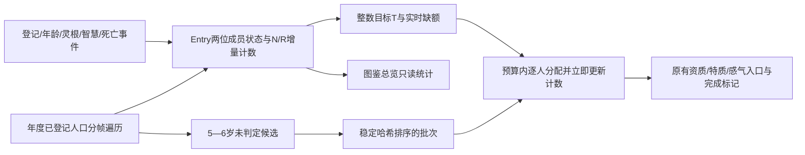

# 0.8.6 灵根人口配额实施与检查记录

## 🌱 自然灵根人口配额（2026-11-05）

- **N**：存活、5岁以上（含5岁）、具备修炼资格且通过原版智慧判断、非全部妖兽的人口。
- **R**：N中实际拥有灵根的人数，包括尚未入道的人物；手动、还真、机缘等来源同样计入。
- **T=floor(N×配置百分比/100)**；仅对5—6岁未完成判定者补足max(0,T−R)，不回收已有灵根、不让成年人补领。
- 事件更新：登记/死亡/满5岁/智慧资格/实际灵根变化，在现有登记Entry内维护两位状态及总计数；界面只读O(1)计数。
- 年度：原候选遍历扩展为已登记人口分帧遍历，同时校正统计与处理原有修炼候选，不另开一轮世界扫描。
- 分配：等待读档重建、年度扫描结束；SortedSet按世界种子＋年度＋ID哈希/ID排序，跨帧每调用最多32人且受共享预算；迟到候选在后续补批次处理。候选跨年重新计算排序键。
- 每人领取前重查存活、资格、年龄、完成标记和实时缺额；失败候选同样完成本次判定。批次未结束时年度世界结算等待。
- 特殊来源保留并可超额；超额时暂停自然新增，旧档不会立即从50%降到10%。妖兽沿用原有规则、不消耗配额。



后台编译299源文件/零警告；隔离回归包含1万/5万人物队列与计数检查。简化对象耗时不是Unity帧耗时，尚未进行真实游戏视觉、完整存读档及CPU/P95实测。

## 后台回归

```text
PASS quota: 0/10/100%, rounding, stable order, shortage/excess, death, specials, sapience, age5/6, no adult refill, config, shared budget, rebuild/load/world reset
10000 population: register=5.57ms, census=2.73ms, allocation=1.84ms, harness allocation=5149832 bytes
50000 population: register=72.82ms, census=8.15ms, allocation=9.56ms, harness allocation=24579792 bytes
```

另已通过：旧法转新法/辅助施法/功法上限缓存、还真自动遗产、契灵规则、契约行点击、辅助法术阶段检查。

复现：`python -X utf8 tools/test-root-population-quota.py`。保留配置键、人物完成字段、灵根存档结构、资源ID；不新增C#文件、公共API或依赖。
